# CBRTS database design

Draft 2 · 2 Oct 2026 (one account per club, air legs, invoices, route versions visible to the customer) · derived from the Figma design (file `FDnnrfMqRcLa2LFYvHCBWv`), `CBRTS-core-flows.docx`, `CBRTS-quotation-builder-section.docx`, PRODUCT.md and the backend skeleton (`BE/`, Flyway `V1__baseline_schema.sql`).

This is the logical and physical design for PostgreSQL. It is not yet a migration: each section lists the tables, their columns, keys and the business rules the schema itself enforces. The rules the application enforces are named as such.

---

## 1. Conventions

| Topic | Rule |
|---|---|
| Engine | PostgreSQL 16, migrations with Flyway (`V<n>__<what>.sql`). |
| Keys | Every table has `id uuid` (UUIDv7, generated by Hibernate before insert, `BaseEntity`). Join tables use a composite primary key. |
| Base columns | Every entity table also has `created_at timestamptz not null default now()` and `updated_at timestamptz`. They are left out of the tables below. |
| Names | `snake_case`, tables plural, foreign keys `<thing>_id`, indexes `<table>_<cols>_idx`, checks `<table>_<col>_check`. |
| Enums | Stored as `varchar(40)` with a `CHECK (col IN (...))` constraint, the same names as the Java enum. Adding an enum value needs a migration that drops and recreates the check (as in the parking project's `payments_method_check`). |
| Money | `numeric(14,2)`. A quotation has exactly one currency (`char(3)`), so money columns under it carry no currency of their own. |
| Time | Instants are `timestamptz`. A calendar date with no time (departure date, document issue date) is `date`. Times are shown in Indochina Time (UTC+7). |
| Human codes | `REQ-YYYY-NNNN` (request), `Q-YYYY-NNNN` (quotation), `CBRT-YYYY-NNN` (job), `TRP-YYYY-NNN` (trip, staff and crew only), `INV-YYYY-NNNN` (invoice), `EF-NNN` (staff). They are unique, never reused, and issued from `code_counters`. |
| History | Records that are legal evidence are append-only: `document_versions`, `trip_records`, `condition_logs`, `audit_log`. A trigger refuses `UPDATE` and `DELETE` on them. |
| Versioned catalogs | A published catalog version is immutable. A request, quotation or job pins the version it used, so a later change never alters it. |
| Derived values | Totals, counts and validity results are computed by the application from their inputs. Where a derived value is stored for speed (quotation totals, checklist results) it is recomputed on every change of its inputs and never typed. |

---

## 2. Domains at a glance

| # | Domain | Tables | Main screens |
|---|---|---|---|
| A | Accounts and access | `roles`, `users`, `user_roles`, `refresh_tokens`, `account_tokens`, `sign_in_attempts` | Access · Sign in / Create account / Staff invite / Reset password, Users & roles |
| B | Clubs and horses | `clubs`, `horses`, `horse_size_classes` | My horses, Horse profile, Add a horse |
| C | Places and corridors | `countries`, `places`, `border_crossings`, `corridors`, `corridor_crossings` | Request · 2 (Route & dates), Route plan, Rate catalog |
| D | Rate catalog | `rate_catalog_versions`, `rate_service_classes`, `rate_lines`, `rate_volume_breaks`, `rate_policies`, `rate_fee_bands` | Rate catalog, Quotation builder |
| E | Regulation catalog | `regulation_catalogs`, `regulation_versions`, `document_types`, `regulation_rules` | Regulation catalog, Clearance checklist |
| F | Requests and quotations | `transport_requests`, `request_horses`, `request_revisions`, `quotations`, `quotation_lines` | Request wizard, Request review, Quotation builder, Quotation, Tracking |
| G | Jobs and clearance | `transport_jobs`, `job_regulation_pins`, `checklist_items`, `document_versions`, `files`, `authorities`, `authority_submissions`, `authority_submission_items`, `quarantine_periods` | Clearance checklist, Document review, Authorities, All documents, Document upload |
| H | Fleet and routes | `trips`, `trip_vehicles`, `trip_horses`, `vehicles`, `vehicle_stalls`, `vehicle_bookings`, `crew_assignments`, `load_plans`, `load_plan_stalls`, `route_plans`, `route_stops`, `route_legs`, `flights` | Load plan, Route plan, Fleet calendar, Vehicles |
| I | Trip and handover | `trip_records`, `condition_logs`, `handovers` | Escort cab screens, Coordinator · Trip, In transit, Delivered, Closed |
| J | Incidents | `incidents`, `incident_options`, `incident_files` | Incident · Held, Incident · Customer report, Report a problem |
| K | Notes and notifications | `notes`, `note_replies`, `notifications` | Ask a question, Customer notes |
| M | Invoices and payments | `invoices`, `invoice_lines`, `payments` | Quotation (deposit), Delivered, Closed, Tracking · Invoice, Invoices, Invoices · Record payment |
| L | Audit and codes | `audit_log`, `code_counters` | Audit log |

---

## 3. Domain A: accounts and access

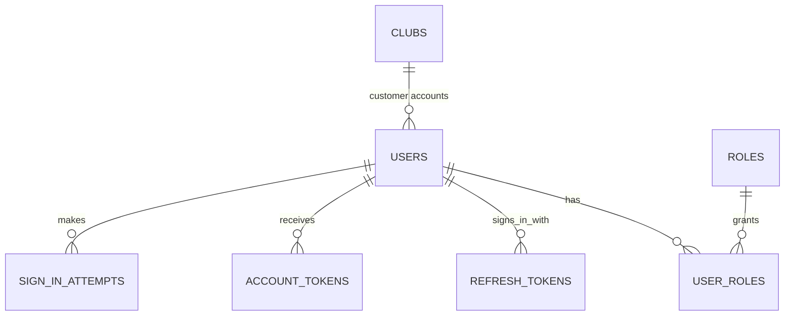

`roles`, `users`, `user_roles` and `refresh_tokens` exist in `V1`. The roles are seeded: `CUSTOMER`, `LOGISTICS_MANAGER`, `TRANSPORT_SPECIALIST`, `FLEET_COORDINATOR`, `ESCORT`.

**`users`**: columns added to V1

| Column | Type | Rule |
|---|---|---|
| `club_id` | uuid → `clubs` | Set for `CUSTOMER` users, null for staff. One account per club: partial unique index on `(club_id) where club_id is not null`. Dropping the index later allows several people per club without other changes. |
| `staff_code` | varchar(10) unique | `EF-015`. Staff only. |
| `escort_kind` | varchar(20) | `DRIVER`, `GROOM`. Only for `ESCORT` users. |
| `status` | varchar(20) | `INVITED`, `ACTIVE`, `LOCKED`, `DISABLED`. |
| `email_verified_at` | timestamptz | Null until the customer confirms the email (Create account · Check your email). |
| `locked_until` | timestamptz | Set after repeated failed sign-ins (Sign in · Locked). |
| `last_active_at` | timestamptz | Users & roles "Last active". |
| `invited_by` | uuid → `users` | Who sent the staff invite. |

Check: a user with `staff_code` is not a customer: `(club_id is null) or (staff_code is null)`.

**`account_tokens`**: one table for every emailed link

| Column | Type | Rule |
|---|---|---|
| `user_id` | uuid → `users` not null | |
| `purpose` | varchar(20) | `VERIFY_EMAIL`, `STAFF_INVITE`, `RESET_PASSWORD`. |
| `token_hash` | varchar(100) unique | Only the hash is stored. |
| `expires_at` | timestamptz not null | Staff invite: 7 days ("Expired" state). |
| `used_at`, `revoked_at` | timestamptz | A token is usable when both are null and `expires_at > now()`. |

A staff invite creates the user first with `status = 'INVITED'` and its role, so Users & roles · Pending invites is a query on `users`.

**`sign_in_attempts`**: `email varchar(255)`, `user_id uuid null`, `succeeded boolean`, `ip inet`, `attempted_at timestamptz`. Index `(email, attempted_at desc)`. It feeds the lock rule and the audit line "3 failed sign-ins for …".

---

## 4. Domain B: clubs and horses

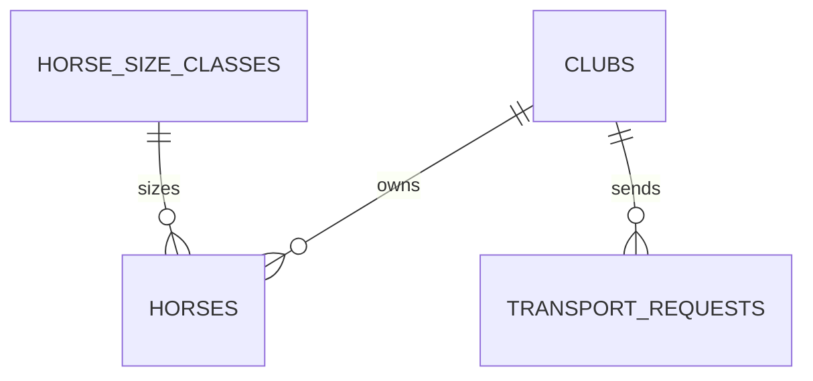

**`clubs`**

| Column | Type | Rule |
|---|---|---|
| `name` | varchar(160) not null | "Saigon Turf Club". |
| `booking_email` | varchar(255) not null | |
| `phone` | varchar(20) | |
| `country_code` | char(2) → `countries` | |

**`horse_size_classes`** (reference, seeded)

| Column | Type | Rule |
|---|---|---|
| `code` | varchar(4) unique | `S`, `M`, `L`, `XL`. |
| `width_in` | smallint | 32, 32, 48, 96: the stall width one horse of the class takes. |
| `max_weight_kg` | smallint | |
| `min_height_hh` | numeric(3,1) not null unique | Lowest height in the class; the server derives a horse's class from its height, raised to at least L for a box stall. Demo bands: S 10.0, M 14.3, L 16.3, XL 17.3. |

**`horses`**

| Column | Type | Rule |
|---|---|---|
| `club_id` | uuid → `clubs` not null | |
| `name` | varchar(80) not null | Unique per club among active horses (partial unique index on `(club_id, lower(name)) where archived_at is null`). |
| `coat` | varchar(20) | `GREY`, `BLACK`, `CHESTNUT`, `BAY`, `OTHER`; drives the coat band. |
| `breed` | varchar(60) | |
| `sex` | varchar(10) not null | `STALLION`, `MARE`, `GELDING`, `COLT`, `FILLY`. Quarantine cost keys off it. |
| `date_of_birth` | date | Age is computed. |
| `height_hh` | numeric(3,1) | 16.2 hh. |
| `weight_kg` | smallint | Load plan payload. |
| `size_class_id` | uuid → `horse_size_classes` not null | |
| `microchip` | varchar(20) unique | |
| `passport_no` | varchar(40) | |
| `declared_value` | numeric(14,2) not null | Insurance base. Taken as stated (out of scope to verify). |
| `value_currency` | char(3) not null default 'USD' | |
| `temperament` | varchar(20) | `CALM`, `NERVOUS`, `AGGRESSIVE`. |
| `required_stall` | varchar(20) not null default 'STANDARD' | `STANDARD`, `BOX`, `CLIMATE`. A stallion or aggressive horse needs `BOX` (application rule, shown as a load-plan conflict). |
| `handling_notes` | text | |
| `archived_at` | timestamptz | A horse is archived, never deleted, because past jobs refer to it. |

---

## 5. Domain C: places and corridors

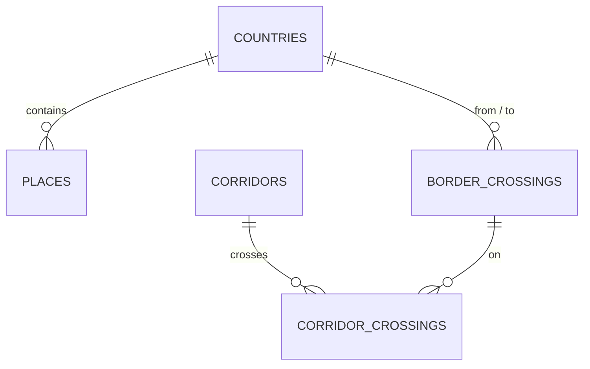

| Table | Columns | Notes |
|---|---|---|
| `countries` | `code char(2)` unique, `name` | ISO 3166-1 alpha-2, check `code ~ '^[A-Z]{2}$'` (V21). Seeded with the launch region: VN, KH, TH, LA, MY, HK. The transport specialist adds any other country in the app (US-F2-12, #207), then creates its regulation catalog (section 7). A code can't be added twice, and a country is never deleted: there is no delete, so a catalog, place or corridor that uses one keeps it. Other tables reference it by `id` (`country_id`). |
| `places` | `name`, `kind`, `city`, `country_code`, `address` | `kind`: `TRAINING_CENTRE`, `STUD`, `RACECOURSE`, `STABLE`, `AIRPORT`, `CARGO_TERMINAL`, `QUARANTINE`, `WELFARE_STOP`. |
| `border_crossings` | `name`, `from_country`, `to_country`, `road_only boolean` | "Mộc Bài – Bavet", "Poipet – Aranyaprathet". |
| `corridors` | `code` unique, `mode`, `origin_city`, `destination_city`, `origin_country_id`, `destination_country_id`, `distance_km`, `date_flex_days` | `mode`: `ROAD`, `AIR`. "RD HCM → PNH", "AIR PNH → HKG". `date_flex_days` smallint not null default 3, check 0–7 (#115): how far a request's flexible dates can move on this route, set by the fleet & route coordinator; 0 means fixed dates only. `origin_country_id` and `destination_country_id` (→ `countries`, not null, V27, US-F7-01) agree with the crossings: a corridor with crossings starts where its first one leaves and ends where its last one enters, and each crossing starts where the previous one ended; a road corridor without crossings stays in one country. A corridor's countries, in order, are its origin country then each country a crossing enters. `CorridorService.create` fills them from the cities' places; `CatalogSeederTest` checks the seeded catalog. `driving_days` smallint not null, check 1–30 (V28, US-F7-02): days to drive the route one way, set by the coordinator and defaulted from the distance at 500 km a day; it gives a trip's length before its route is planned and how long an empty drive back takes. |
| `corridor_crossings` | `corridor_id`, `border_crossing_id`, `seq` | Primary key `(corridor_id, seq)`. The request works out its crossings from here. |

---

## 6. Domain D: rate catalog (versioned)

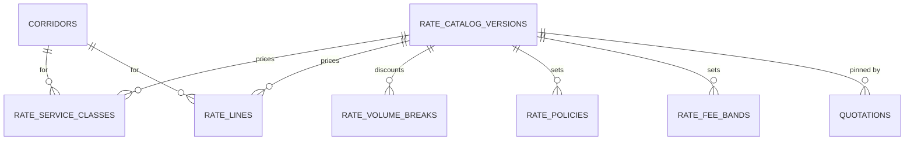

**`rate_catalog_versions`**: `version_no int unique`, `status` (`DRAFT`, `PUBLISHED`, `RETIRED`), `published_at`, `published_by → users`, `change_note`.
- At most one draft: partial unique index on `(status) where status = 'DRAFT'`.
- A published version is immutable. The child tables refuse writes when their version is not a draft (trigger).

**`rate_service_classes`** (air stall classes)

| Column | Type | Rule |
|---|---|---|
| `version_id` | → `rate_catalog_versions` | |
| `corridor_id` | → `corridors` | Air corridors only. |
| `service_class` | varchar(10) | `ECONOMY`, `BUSINESS`, `FIRST`. Unique `(version_id, corridor_id, service_class)`. |
| `width_per_horse_in` | smallint | 32, 48, 96. |
| `horses_per_position` | smallint | 3, 2, 1: one position is 96 in. |
| `position_rate` | numeric(14,2) | |

**`rate_lines`**: every line the quotation builder can expand

| Column | Type | Rule |
|---|---|---|
| `version_id`, `corridor_id` | uuid | `corridor_id` null means "every corridor". |
| `code` | varchar(40) | Unique `(version_id, corridor_id, code)`. |
| `group_code` | char(1) | `A`–`H` (origin ground, pre-export, air, escort, documentation, post-arrival, destination ground, surcharges). |
| `description` | varchar(160) | |
| `basis` | `RateBasis` | `PER_HORSE`, `PER_SHIPMENT`, `PER_KM`, `PER_DAY`, `PER_CROSSING`, `PER_HOUR`, `PER_POSITION`, `PER_THREE_HORSES` (grooms), `FLIGHT_VET` (air only: from the horse threshold, above the high-value threshold, or when a vet escort is asked for), `VET_ESCORT` (road only: once per shipment when the customer asks for a vet escort; an air move's vet is `FLIGHT_VET`). |
| `applies_to_sex` | varchar(10) | Pre-export isolation is priced per sex; null for every other line. |
| `rate` | numeric(14,2) not null | |
| `min_charge` | numeric(14,2) | "minimum charge applies". |
| `certainty` | varchar(10) | `FIXED`, `ESTIMATED` (waiting time). |
| `covered_by_road_leg` | boolean not null, default false | Not charged at an end of the move a domestic road leg to or from a hub covers (US-F1-09, US-F3-21), so the stables-to-terminal move is charged once: a group `A` line at the origin, `G` at the destination. Check: only on group `A` or `G` lines. Set on the air corridors' `TRANSFER_ORIGIN` and `TRANSFER_DEST`. |

**`rate_volume_breaks`**: `version_id`, `corridor_id null`, `min_horses`, `max_horses null`, `discount_pct numeric(5,2)`. Check `min_horses <= coalesce(max_horses, min_horses)`. The application rejects overlapping bands.

**`rate_policies`**: one value per key and version, primary key `(version_id, key)`

| Key | Example | Meaning |
|---|---|---|
| `FUEL_PCT` | 18 | On air lines, after the volume break. |
| `INSURANCE_PCT` | 1.5 | Of total declared value. |
| `CONTINGENCY_PCT` | 5 | Of the cost base. |
| `SERVICE_FEE_PCT` | 12 | After contingency. |
| `DEPOSIT_PCT` | 30 | |
| `QUOTE_VALIDITY_DAYS` | 7 | BR-F1-03. |
| `FLIGHT_VET_MIN_HORSES` | 8 | |
| `HIGH_VALUE_THRESHOLD` | 250000 | A flight vet joins above it. |
| `ARRIVAL_WINDOW_PCT` | 20 | Of ground lines, road only, private trailer. |
| `ARRIVAL_WINDOW_MIN_HOURS` | 3 | |
| `LATE_PENALTY_PCT_PER_HOUR` | 10 | Of the job total, per started hour after the window closes. |
| `LATE_PENALTY_CAP_PCT` | 30 | |
| `ESTIMATE_BAND_PCT` | 15 | The customer estimate's minimum half-width; the band is never narrower than the share of ESTIMATED lines (BR-Q-11). |
| `STALL_PAYLOAD_KG` | 5504 | Kilograms one air stall carries: the heaviest horses that could share a stall (economy 3, business 2, first 1) must not exceed it (BR-Q-16). Whole kilograms, 1 to 99,999. Weight never prices a line. |
| `AIR_SHIPMENT_MAX_KG` | 20000 | The most kilograms of horses one air shipment carries (BR-Q-16); the seeded figure is a demo value. Whole kilograms, 1 to 99,999. |

**`rate_fee_bands`**: `version_id`, `kind` (`CANCELLATION`, `SHORT_NOTICE`), `min_days`, `max_days null`, `value numeric(6,3)`.
- Cancellation (value is the fee %): more than 30 days → 10, 15–30 → 25, 7–14 → 50, under 7 → 100.
- Short notice (value is a price multiplier): under 14 days → 1.25, 14–21 days → 1.10.

---

## 7. Domain E: regulation catalog (versioned per country)

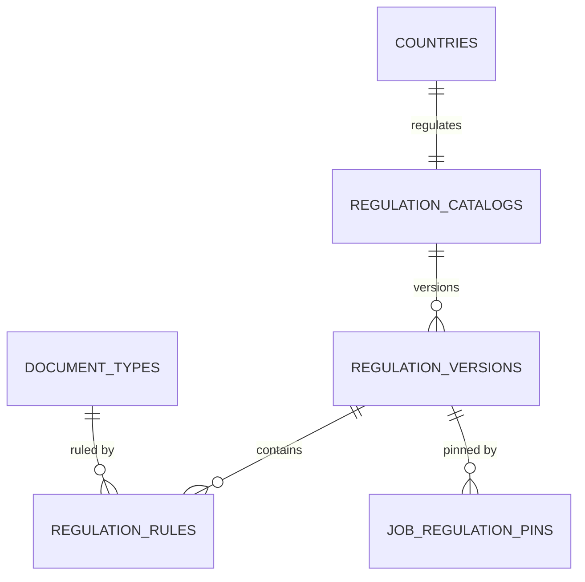

| Table | Columns | Rules |
|---|---|---|
| `regulation_catalogs` | `country_id` unique, `name` | "Cambodia import". One per country, created in the app with its first version as a `DRAFT` (US-F2-12). |
| `regulation_versions` | `catalog_id`, `version_no`, `status` (`DRAFT`, `PUBLISHED`, `RETIRED`), `published_at`, `published_by`, `lead_time_days` (the cross-border lead time into this country: 21, Laos 30 in the demo), `domestic_lead_time_days` (a move within the country: 3), `quarantine_min_days` (7), `arrival_buffer_days` (2) | Unique `(catalog_id, version_no)`; at most one `DRAFT` per catalog (`regulation_versions_draft_idx`). Immutable once published: only a draft's parameters and rules change. A version with no rules can't be published, since it would clear every job into the country without checking a document. |
| `document_types` | `code` unique, `name`, `scope`, `provided_by`, `category` | `scope`: `PER_HORSE`, `PER_SHIPMENT`, `PER_CROSSING`. `provided_by`: `CUSTOMER`, `AUTHORITY`. `category`: `HEALTH`, `IDENTITY`, `PERMIT`, `TRANSPORT`; the `HEALTH` documents decide a horse's health status for the biosecurity warnings on a shared trip (US-F3-12). Codes: `EQUINE_PASSPORT`, `PROOF_OF_OWNERSHIP` (identity), `INFLUENZA_VACCINATION`, `EIA_TEST`, `PIROPLASMOSIS_TEST`, `EXPORT_HEALTH_CERT` (health), `IMPORT_PERMIT` (permit), `TRANSIT_INSURANCE`, `CUSTOMS_VALUE_DECLARATION` (transport). |
| `regulation_rules` | `version_id`, `document_type_id`, `mandatory`, `rule_kind`, `min_days`, `max_days`, `description` | `rule_kind`: `WINDOW_BEFORE_DEPARTURE` (EIA sampled within 60 days), `VALID_THROUGH_ARRIVAL_PLUS` (passport valid through arrival + 2 days), `BOOSTER_WINDOW` (influenza 7–180 days before), `PRESENCE_ONLY`. Unique `(version_id, document_type_id)`. Rules are added, edited and removed only in a draft; the days follow the kind (`WINDOW_BEFORE_DEPARTURE` and `VALID_THROUGH_ARRIVAL_PLUS` take `max_days`, `BOOSTER_WINDOW` both with `min_days <= max_days`, `PRESENCE_ONLY` none). |

A rule is data with parameters, not code, so the validity engine (BR-F2-02) evaluates `GREEN`, `AMBER` or `RED` against the job's dates.

Every change to a catalog (country added, catalog created, draft parameters changed, rule added, edited or removed, draft created, discarded or published) writes an `audit_log` row through `AuditService.recordDecision`, with the version as `KH v8`. Only the transport specialist makes them.

---

## 8. Domain F: requests and quotations

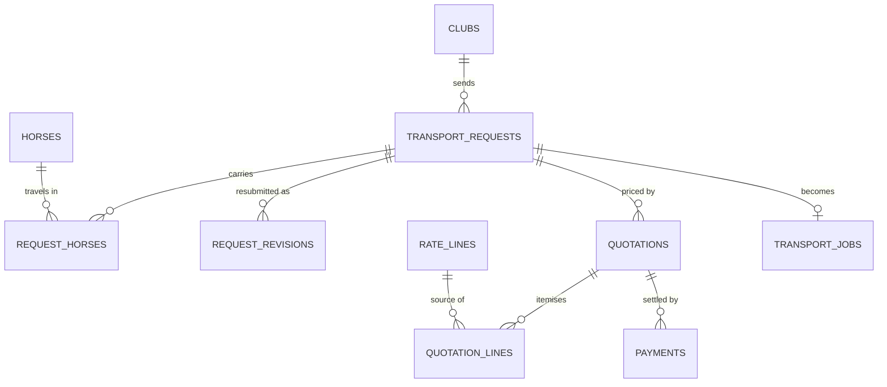

**`transport_requests`**

| Column | Type | Rule |
|---|---|---|
| `code` | varchar(14) unique | `REQ-2026-0193`. Issued at submission from `code_counters`; null for a draft. |
| `club_id` | → `clubs` not null | |
| `created_by` | → `users` | |
| `status` | varchar(20) | `DRAFT`, `SUBMITTED`, `UNDER_REVIEW`, `INFO_REQUIRED`, `QUOTED`, `CUSTOMER_ACCEPTED`, `APPROVED`, `REJECTED`, `EXPIRED`, `CANCELLED` (Flow 1 state machine). |
| `mode` | varchar(10) | `ROAD`, `AIR`. |
| `trailer` | varchar(10) | `SHARED`, `PRIVATE`. Road only. |
| `air_class` | varchar(10) | `ECONOMY`, `BUSINESS`, `FIRST`. Air only. |
| `insurance` | varchar(20) | `OWN_POLICY`, `EQUIFREIGHT`. |
| `vet_escort` | boolean default false | Added automatically from 8 horses or when a declared value is over the threshold (application rule). |
| `origin_place_id`, `destination_place_id` | → `places` | Null while a draft names a city we don't run. |
| `origin_text`, `destination_text` | varchar(160) | What the customer typed when it matches no place ("Singapore"). Kept so the logistics manager sees the ask. Never set together with the place of the same end (check). |
| `corridor_id` | → `corridors` | Resolved from the places. Null means the route is not one we run. On a move between a city no corridor joins and a hub, it is the corridor from hub to hub (US-F1-09). |
| `first_leg_corridor_id`, `last_leg_corridor_id` | → `corridors` null | V31, US-F1-09: the domestic road legs before and after `corridor_id`, from the origin's city to the hub it leaves from and from the hub it arrives in to the destination's city (Da Nang → Ho Chi Minh City, then the flight to Hong Kong). A hub is not a table: it is a city a corridor starts or ends in. Set only when no corridor joins the two cities and `corridor_id` crosses a border; two domestic corridors are never chained. The legs are priced into the same quotation (group A before, G after) from their own corridors' per-km road rates, and at approval each becomes a trip of the job's chain. |
| `departure_date` | date | Required once submitted. |
| `date_flex_days` | smallint default 0, check 0–7 | 0 is fixed dates. With flexible dates, the route's `corridors.date_flex_days`, followed while a draft and copied when the request is submitted (#115). |
| `arrival_mode` | varchar(10) default 'ANY_TIME' | `ANY_TIME`, `WINDOW`. |
| `window_start`, `window_end` | timestamptz | The arrival window. |
| `special_instructions` | varchar(500) | |
| `estimate_low`, `estimate_high` | numeric(14,2) | The range shown when the request was submitted, kept so a quotation can be compared with it ("Inside your range"). |
| `submitted_at` | timestamptz | |
| `lead_time_override_by`, `lead_time_override_at`, `lead_time_override_reason` | | Express override (REQ-2026-0190). |
| `reject_reason` | varchar(500) | Required when `REJECTED` (check). |
| `info_required_note` | varchar(1000) | Required when `INFO_REQUIRED` (check). |
| `cancelled_at`, `cancellation_fee_pct` | | Fee band at the time of cancelling (BR-F1-07). |

Checks (the arrival-window rule):
- `(arrival_mode = 'ANY_TIME' and window_start is null and window_end is null) or (arrival_mode = 'WINDOW' and mode = 'ROAD' and trailer = 'PRIVATE' and date_flex_days = 0 and window_end - window_start >= interval '3 hours')`
- `(mode = 'ROAD' and air_class is null) or (mode = 'AIR' and trailer is null)`

Check (routes we run): `submitted_at is null or (corridor_id is not null and departure_date is not null)`. A route outside the catalog can be saved as a draft and asked about (a `notes` row with topic `ROUTE`), never submitted or quoted. It is keyed on submission rather than `status = 'DRAFT'` so it stays true if a never-submitted draft is ever cancelled.

Checks (submission): `(code is null) = (submitted_at is null)`, and `status in ('DRAFT', 'CANCELLED') or submitted_at is not null`.

The 3 hours in the check mirrors `ARRIVAL_WINDOW_MIN_HOURS`. If the catalog value changes, the check moves to the application.

**`request_horses`**: primary key `(request_id, horse_id)`.
- Snapshot columns so later edits to the horse don't change a request: `declared_value`, `sex`, `size_class_code`, `required_stall`, `weight_kg`. Written on every draft save and refreshed at submission.
- `weight_kg smallint null`: the horse's weight for the air stall-load and shipment checks (BR-Q-16). V26 back-filled it from the horse profiles for every request except approved ones, whose horses are locked; a null weight refuses a quotation but not the customer's estimate.
- `with_foal boolean not null default false`: a mare travelling with a foal at foot, on this trip. Check `not with_foal or sex = 'MARE'`.
- Once the request is `APPROVED`, the horse list is locked (BR-F1-06; application rule plus a trigger that refuses inserts and deletes).

**`request_revisions`**: `request_id`, `revision_no`, `payload jsonb`, `submitted_at`, `note`. Unique `(request_id, revision_no)`. It keeps both versions visible after an `INFO_REQUIRED` round.

**`quotations`**

| Column | Type | Rule |
|---|---|---|
| `code` | varchar(14) | `Q-2026-0188`. Shared by all versions of one quotation. |
| `request_id` | → `transport_requests` not null | |
| `version_no` | smallint | Unique `(request_id, version_no)`. |
| `status` | varchar(12) | `DRAFT`, `ISSUED`, `ACCEPTED`, `DECLINED`, `EXPIRED`, `SUPERSEDED`. |
| `rate_catalog_version_id` | → `rate_catalog_versions` not null | Pinned. |
| `currency` | char(3) | |
| `fx_rates` | jsonb | Rates pinned at issue (step "Convert"). |
| `prepared_by` | → `users` | Logistics manager. |
| `issued_at`, `valid_until` | timestamptz | `valid_until = issued_at + validity days`. |
| `subtotal`, `volume_break`, `fuel`, `insurance`, `contingency`, `service_fee`, `arrival_window_surcharge`, `total` | numeric(14,2) | Computed in the fixed order of the quotation spec. Stored once issued, because an issued quotation is a document. |
| `deposit_pct`, `deposit_amount` | | |
| `late_penalty_pct_per_hour`, `late_penalty_cap_pct` | numeric(5,2) | Copied from the pinned catalog when there is an arrival window; part of the contract. |
| `accepted_at`, `accepted_by`, `declined_at`, `decline_reason` | | |
| `superseded_reason` | varchar(300) | "Departure moved from 12 Nov to 20 Nov." |
| `issued_snapshot` | jsonb | Set at issue: what the engine would otherwise re-derive (the totals' wording, the stall sizing, the request as quoted), so an issued version reads the same forever and is never re-priced. |
| `reminder_sent_at` | timestamptz | Set when the club was reminded, a day before `valid_until`; the hourly expiry job reminds once, then expires. |

Indexes and checks:
- One accepted version per request: partial unique index on `(request_id) where status = 'ACCEPTED'`.
- An issued quotation cannot have a line without a rate (BR-Q-08): checked by the application before issue. "Blocked" builder state.

**`quotation_lines`**

| Column | Type | Rule |
|---|---|---|
| `quotation_id` | → `quotations` on delete cascade | |
| `group_code` | char(1) | `A`–`H`. |
| `position` | smallint | Order inside the group. |
| `description`, `basis_text` | varchar | "per day · 14 days". |
| `basis` | varchar(20) | As in `rate_lines`. |
| `quantity` | numeric(10,2) | Derived from the request, never typed. |
| `unit_rate` | numeric(14,2) | Null means "No rate" (blocks issue). |
| `source` | varchar(10) | `CATALOG`, `MANUAL`. |
| `rate_line_id` | → `rate_lines` | Set when `source = 'CATALOG'`. |
| `horse_id` | → `horses` | For per-horse lines (isolation for Nightfall). |
| `certainty` | varchar(12) | `FIXED`, `ESTIMATED`, `OVERRIDDEN`. |
| `estimate_note` | varchar(300) | Why an estimated line can vary. |
| `catalog_amount` | numeric(14,2) | `quantity × unit_rate`. |
| `override_amount` | numeric(14,2) | |
| `override_reason` | varchar(300) | Check: `override_amount is null or override_reason is not null` (mandatory reason). |
| `line_total` | numeric(14,2) not null | `coalesce(override_amount, catalog_amount)`. Never entered. |
| `line_key` | varchar(80) | The line's identity across re-prices and revisions, where catalog line ids change: the rate line's code (plus the horse for a per-day line of one horse), `STALL`, `MISSING:n` for a gap, `MANUAL:<uuid>` for an added line. Overrides and manual lines are carried by it. |
| `manual_reason` | varchar(300) | Why the logistics manager added the line. Check: `manual_reason is null or (source = 'MANUAL' and unit_rate is not null)`. |

Deposits, the final invoice and payments are in section 13A.

---

## 9. Domain G: jobs and clearance

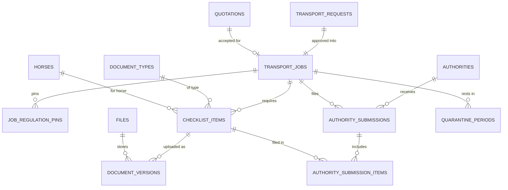

**`transport_jobs`**

| Column | Type | Rule |
|---|---|---|
| `code` | varchar(14) unique | `CBRT-2026-041` (BR-F1-05). |
| `request_id` | → `transport_requests` unique | Exactly one job per approved request. |
| `quotation_id` | → `quotations` not null | The accepted version. |
| `approved_by`, `approved_at` | | Logistics manager only (BR-F1-04). |
| `transport_specialist_id`, `coordinator_id` | → `users` | The team the logistics manager assigns at approval (US-F1-07): the transport specialist who owns the documents and clearance, and the fleet & route coordinator who plans the job. Role-checked by trigger; null only on jobs approved before V3. |
| `stage` | varchar(12) | `DOCUMENTS`, `CLEARANCE`, `TRIP`, `HANDOVER`, `CLOSED`: stages 4–7 of the seven. |
| `dossier_status` | varchar(30) | `OPEN`, `SUBMITTED_TO_AUTHORITY`, `ADDITIONAL_INFO_REQUIRED`, `CLEARANCE_READY` (Flow 2). |
| `clearance_ready_at` | timestamptz | When the gate opened ("Cleared 17 Oct, 16:20 by Lan"). |
| `trip_status` | varchar(12) | `NOT_STARTED`, `DEPARTED`, `HELD`, `ARRIVED`, `DELIVERED`. |
| `planned_departure_at`, `planned_arrival_at` | timestamptz | Changing them re-evaluates every checklist item (Flow 2, B8). |
| `window_start`, `window_end` | timestamptz | Copied from the request; the route is planned backwards from `window_end`. |
| `signed_off_at`, `signed_off_by` | | Logistics manager only (US-F3-08); released to crew. |
| `departed_at`, `delivered_at`, `closed_at` | timestamptz | |
| `closed_by`, `on_time`, `late_minutes` | → `users`, boolean, integer | The closing (US-F6-04): who closed it, and whether the horses arrived on time (minutes after the window closed, less a stopped clock; without a window, after the planned arrival). Required on a `CLOSED` job (`transport_jobs_closed_check`). |

Checks:
- The clearance gate: `departed_at is null or (dossier_status = 'CLEARANCE_READY' and clearance_ready_at <= departed_at)` (BR-F2-03).
- `window_end is null or window_start < window_end`.

**`job_regulation_pins`**: `job_id`, `regulation_version_id`, `role` (`ORIGIN`, `TRANSIT`, `DESTINATION`). Primary key `(job_id, regulation_version_id)` (BR-F2-01).

**`checklist_items`**: one per horse × document type, or per shipment or crossing

| Column | Type | Rule |
|---|---|---|
| `job_id` | → `transport_jobs` not null | |
| `document_type_id` | → `document_types` | |
| `regulation_rule_id` | → `regulation_rules` | The pinned rule it is checked against. |
| `horse_id` | → `horses` | Required when the scope is `PER_HORSE`. |
| `border_crossing_id` | → `border_crossings` | Required when the scope is `PER_CROSSING`. |
| `status` | varchar(20) | `NOT_ISSUED`, `AWAITING_UPLOAD`, `IN_REVIEW`, `CLEARED`, `REJECTED`, `WITH_AUTHORITY`. |
| `validity` | varchar(5) | `GREEN`, `AMBER`, `RED`: the last result against the job's dates. |
| `validity_note` | varchar(300) | "77 days old at departure. Upload a test sampled on 19 Aug or later." |
| `evaluated_at` | timestamptz | |
| `holder` | varchar(12) | `CUSTOMER`, `SPECIALIST`, `AUTHORITY`: who owes the next step. |
| `due_date` | date | Drives "Due in 8 days" and the T-7/T-3/T-1 reminders. |
| `current_version_id` | → `document_versions` | |

Uniqueness: `(job_id, document_type_id, horse_id, border_crossing_id)` with `nulls not distinct`.

The gate rule, as a query: the job is `CLEARANCE_READY` when every mandatory item is `CLEARED` with `validity = 'GREEN'` and quarantine is complete. AMBER never counts.

**`document_versions`** (append-only, BR-F2-05)

| Column | Type | Rule |
|---|---|---|
| `checklist_item_id` | → `checklist_items` not null | |
| `version_no` | smallint | Unique `(checklist_item_id, version_no)`. |
| `file_id` | → `files` not null | |
| `issued_on`, `sampled_on`, `valid_until` | date | What the validity rule reads. |
| `issuer` | varchar(120) | "PVI Insurance", "Dept. of Animal Health". |
| `uploaded_by`, `uploaded_at` | | Customer or specialist. |
| `review` | varchar(10) | `PENDING`, `APPROVED`, `REJECTED`. |
| `reviewed_by`, `reviewed_at` | | Transport specialist only (BR-F2-04). |
| `reject_reason` | varchar(500) | Required when `REJECTED`, visible to the customer (BR-F2-07). |

The review decision is the one update allowed on this table: a trigger allows changing `review*` from `PENDING` once, and nothing else.

**`files`**: `storage_key` unique, `file_name`, `content_type`, `size_bytes`, `sha256`, `uploaded_by`. Holds documents, incident photos and signed handover forms.

**`authorities`**: `name` ("Cambodia’s GDAHP", "Dept. of Animal Health (VN)", "Customs, Mộc Bài"), `country_code`, `kind` (`VETERINARY`, `CUSTOMS`, `QUARANTINE`), `sla_days`.

**`authority_submissions`**: the offline step the specialist records

| Column | Type | Rule |
|---|---|---|
| `job_id`, `authority_id` | | |
| `kind` | varchar(30) | `EXPORT_HEALTH_CERTS`, `IMPORT_PERMIT`, `CUSTOMS_DOSSIER`. |
| `status` | varchar(20) | `READY_TO_FILE`, `FILED`, `ADDITIONAL_INFO`, `ISSUED`, `REFUSED`. "Overdue" is computed from `expected_by`. |
| `filed_at`, `filed_by`, `reference_no` | | "ref KH-IP-2026-3381". |
| `expected_by` | date | SLA. |
| `issued_at` | timestamptz | |
| `result_file_id` | → `files` | The permit or certificate, attached to the job. |

**`authority_submission_items`**: `(submission_id, checklist_item_id)`, the documents a dossier carries.

**`quarantine_periods`**: `job_id`, `horse_id null` (null = the whole load), `place_id`, `starts_on`, `ends_on`, `completed_at`. Check `ends_on - starts_on >= ` the pinned `quarantine_min_days` (application rule, BR-F2-06).

---

## 10. Domain H: fleet and routes

A **trip** is what physically moves: a route, one or more vehicles with their crews, and the horses of one or more jobs (`docs/shared-trips-design.md`). The job stays the commercial and legal unit. A job that shares nothing is a trip with one job and one vehicle, and every job is approved onto a trip of its own (US-F3-09). A convoy is a trip with several vehicles (US-F3-10). Several jobs can share a trip (US-F3-11): only jobs whose customer chose a shared trailer, on the trip's corridor, with one departure day every job allows (its date ± its flex days) and room on the trailers; a horse can't ride a trip twice. The coordinator puts a job on another job's trip or takes it off onto a trip of its own, before departure only. Either reopens every trip it touches, and a trip nobody rides any more releases its bookings and crew. Prices don't change. Departure needs every job on the trip cleared; departures, holds and checkpoints move every job on it, while arrival, delivery and handover move the job whose stop it is, and the trip is `DELIVERED` when no job is left on it. The customer's trip page shows only their own stops and horses. Horses of different jobs on one trailer raise biosecurity warnings (US-F3-12), derived from each job's quarantine periods and `HEALTH` checklist items: an isolation mismatch, different health tests required, and health documents not `CLEARED` and `GREEN`. They don't block; the coordinator accepts them when sharing and when confirming the load, recorded in `trip_warning_acceptances` and the audit log.

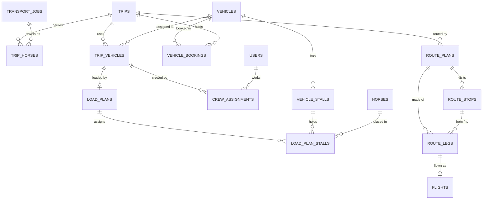

| Table | Columns | Rules |
|---|---|---|
| `trips` | `code` unique (`TRP-2026-014`, from `code_counters`), `corridor_id`, `status` (`NOT_STARTED`, `DEPARTED`, `HELD`, `ARRIVED`, `DELIVERED`, the `TripStatus` type the job uses), `planned_departure_at`, `created_by` | All of a trip's jobs share its corridor (application). Customers never see the code. While a trip carries one job, its status follows that job's `trip_status`, and `planned_departure_at` is set by the confirmed route's pickup. |
| `trip_vehicles` | `trip_id`, `vehicle_id`, `seq` | Unique `(trip_id, vehicle_id)` and `(trip_id, seq)`. A convoy is a trip with several rows: the trailers share one route and schedule, depart together and are recorded at each stop together (one trip log). Choosing another vehicle for a draft load plan replaces `vehicle_id` in place, so the crew stays. Adding or taking out a vehicle is refused after departure (only an incident can, US-F5-06); before it, it reopens the trip: the confirmed load plans go back to `DRAFT`, the confirmed route is `SUPERSEDED` by a new draft version carrying its stops and legs, and the sign-off is cleared. A vehicle taken out takes its load plan, placements, crew and booking with it; the trip keeps at least one. |
| `trip_horses` | `trip_id`, `job_id`, `horse_id`, `status` (`ON_TRIP`, `MOVED`, `DELIVERED`, `LEFT_IN_CARE`, `PLANNED`, `HANDED_ON`) | Unique `(trip_id, horse_id)`. A job's horse is on one trip at a time: unique `(job_id, horse_id)` where `status = 'ON_TRIP'`. It is per job, not per horse, because one horse may be on two jobs not yet delivered (an outbound move and a later return). The horse belongs to the job's request, and before departure all of a job's horses are on one trip (application). Delivered horses become `DELIVERED`. A job has no trip column: its trip is the one its horses are on. On a journey of several trips (US-F3-16, V22), a horse is `PLANNED` on each later trip while it is `ON_TRIP` on the first; when a trip hands it on, it is `HANDED_ON` there and `ON_TRIP` on the next. |
| `trip_jobs` | `trip_id`, `job_id`, `status TripStatus`, `departed_at`, `delivered_at`, `signed_off_at`, `signed_off_by` | A job's part on one trip (US-F5-06, V14): unique `(trip_id, job_id)`. Departure, sign-off and delivery are per part, so a job an incident split across trips moves along each one separately; the job's own `trip_status`, `departed_at` and `delivered_at` sum up its parts (delivered only when every horse is `DELIVERED` or `LEFT_IN_CARE`). V14 makes each job's existing part from its own fields and drops `transport_jobs_clearance_gate_check`: the clearance gate holds each part's departure in the application, except a domestic part before the border (US-F2-13), which departs before the dossier clears and leaves the job's own `departed_at` empty until the part that crosses the border departs. `next_trip_job_id null` → `trip_jobs` (V23, US-F3-16): the part on the next trip of the job's journey, which this part hands its horses on to; check it isn't the row itself. Not unique: two parts hand on to one when an incident moved some horses off a trip of the journey. A trip with parts still to hand on to it can't depart (application). |
| `trip_warning_acceptances` | `trip_id`, `warning_key`, `summary`, `accepted_by`, `accepted_at` | Unique `(trip_id, warning_key)`. The key is a hash of what the warning says (the jobs, the horses and what differs), so an unchanged accepted warning isn't asked again and a changed one (a document expired, quarantine moved) is. |
| `vehicles` | `code` unique (TX-447), `kind` (`TRAILER`, `TRUCK`), `payload_kg` (3,200), `status` (`ACTIVE`, `MAINTENANCE`, `RETIRED`), `home_country_id` | `home_country_id` (→ `countries`, not null, V27, US-F7-01): where the vehicle is based, and where it is when it has run no trip yet. `home_city varchar(80) not null` (V30, US-F7-03): the city it is based in and where it is with no trip yet; `home_country_id` follows from that city's places. V30 backfilled the city most of its home-country corridors start from. `available_on date null` (V28, US-F7-02): the date the coordinator expects it back, for what the calendar doesn't know; it counts only while it is later than the worked-out date. |
| `vehicle_countries` | `vehicle_id`, `country_id` | Primary key on both (V27). The foreign countries the vehicle holds a permit for; the home country is never listed. A permit stays while one of the vehicle's operating corridors needs it. |
| `vehicle_corridors` | `vehicle_id`, `corridor_id` | Primary key on both (V27). The road corridors the vehicle works. One is added only when the vehicle holds a permit for every country on it. A road trip takes a vehicle only on one of these, from the country the trip starts in (where the vehicle is: the destination country of its last trip booking ending by then, or its home country), with no other booking overlapping; refused at every point a vehicle joins a trip (`VehicleAvailability`). A corridor stays while the vehicle is on a trip on it that hasn't ended. V27 backfilled existing vehicles as based in VN, permitted everywhere and running every road corridor. |
| `vehicle_stalls` | `vehicle_id`, `position_no`, `stall_type` (`STANDARD`, `BOX`, `CLIMATE`), `row_no`, `side` (`LEFT`, `RIGHT`), `near_ramp` | Unique `(vehicle_id, position_no)`. |
| `vehicle_bookings` | `vehicle_id`, `trip_id null`, `kind` (`JOB`, `MAINTENANCE`, `HOLD`), `starts_at`, `ends_at` | Fleet calendar. `trip_id` is set exactly when `kind` is `JOB` (check): one booking per vehicle per trip, however many jobs it carries. `RESERVED` (V28, US-F7-02) is a vehicle held for an accepted request: `request_id` (→ `transport_requests`, cascade) is set exactly when `kind` is `RESERVED` (check, V29). It runs from the start of the departure day for the corridor's driving days, is placed when the customer accepts, rechecked at approval, released when the request is rejected or cancelled, and gives way to the trip's `JOB` bookings when its load plan is confirmed. A hold makes the vehicle busy like any booking, and also says where the vehicle will be after it. No double booking: exclusion constraint `exclude using gist (vehicle_id with =, tstzrange(starts_at, ends_at) with &&)` (needs `btree_gist`). |
| `crew_assignments` | `trip_id`, `trip_vehicle_id null`, `user_id`, `crew_role` (`DRIVER`, `GROOM`, `FLYING_GROOM`, `VET`) | Every row names its trip. A trailer's crew names the trailer: unique `(trip_vehicle_id, user_id)`, the load plan names it first, one person rides one vehicle of the trip (application), every vehicle needs a driver, and grooms = ⌈horses on that vehicle ÷ 3⌉ (every horse on the trip while it has one vehicle). The trip's flight crew has no trailer (check: only `FLYING_GROOM` and `VET`), unique `(trip_id, user_id)` among them: flying grooms = ⌈horses on the flight ÷ 3⌉ and a flight vet from the catalog's horse threshold, above its high-value threshold, or when a job asked for a vet escort; checked at sign-off (US-F3-15). A flying groom may also ride a trailer to the airport.
| `load_plans` | `trip_vehicle_id` unique, `status` (`DRAFT`, `CONFIRMED`), `confirmed_by`, `confirmed_at` | One plan per vehicle on the trip; the vehicle is the trip vehicle's. The trip's plans are confirmed together: every horse on the trip placed on exactly one of them, no conflict on any, and every vehicle booked for the trip's dates. A confirmed plan's vehicle can't be swapped. |
| `load_plan_stalls` | `load_plan_id`, `vehicle_stall_id`, `horse_id` | Unique `(load_plan_id, vehicle_stall_id)` and `(load_plan_id, horse_id)`. A horse stands on one vehicle of the trip: every change takes all the trip's plans under a row lock and checks it (application). Conflicts are computed, not stored: a box need in a standard stall, a stallion beside a mare, payload over the limit. |
| `route_plans` | `trip_id`, `version_no`, `status` (`DRAFT`, `CONFIRMED`, `SUPERSEDED`), `distance_km`, `duration_min`, `confirmed_by`, `confirmed_at`, `superseded_at`, `change_reason` | Unique `(trip_id, version_no)`. One confirmed plan per trip (partial unique index). Re-planning (Flow 5) confirms a new version and marks the old one `SUPERSEDED` with the reason; nothing is deleted. The customer sees every version that was ever confirmed, newest first, each with its reason ("Re-routed via Poipet: Mộc Bài closed to vehicles over 10 t"). Drafts are staff-only. |
| `route_stops` | `route_plan_id`, `seq`, `kind` (`PICKUP`, `BORDER`, `WELFARE`, `DELIVERY`, `AIRPORT_OUT`, `AIRPORT_IN`, `QUARANTINE`, `REFUELLING`, `TRANSFER`), `job_id null`, `place_id null`, `border_crossing_id null`, `planned_at`, `planned_stay_min`, `details` | Primary key `(route_plan_id, seq)`. Check: a `BORDER` stop has a crossing, every other kind has a place. Check: a `PICKUP`, `DELIVERY` or `TRANSFER` stop names the job whose horses it collects, hands over or hands on to the next trip of the job's journey (V23, US-F3-16), and no other kind does; a route ends with a delivery or a transfer; border, welfare and other stops belong to the whole trip. With an arrival window, the delivery stop's `planned_at` must be before `transport_jobs.window_end` (application rule; the page shows the spare time). |
| `route_legs` | `route_plan_id`, `seq`, `from_stop_id`, `to_stop_id`, `mode` (`ROAD`, `AIR`), `vehicle_id null`, `distance_km`, `planned_min` | The line between two stops. A road leg names the vehicle; an air leg has a `flights` row. A road-only trip is all `ROAD` legs, so today's screens need nothing new. |
| `flights` | `route_leg_id` unique, `airline`, `flight_no`, `aircraft_type`, `stall_capacity`, `scheduled_departure_at`, `scheduled_arrival_at`, `estimated_departure_at`, `estimated_arrival_at` | The airline owns the times, so scheduled and latest estimated times are kept apart; actual times come from trip records. An air trip screen draws the same stop list as road, with the flight leg showing flight number and times between the two airport stops. Every job on the trip flies on it; `stall_capacity` is the positions the airline gives the trip, and each job's waybill, positions and class are a `flight_allocations` row (US-F3-15, V13). |
| `flight_allocations` | `flight_id`, `job_id`, `air_waybill`, `stall_positions > 0`, `service_class` | One consignment per job on a flight: unique `(flight_id, job_id)`, and the air waybill unique on the flight. A new route version copies them with the flight. Positions start from the job's quotation (its `PER_POSITION` line), else one per horse; together they fit in `flights.stall_capacity`. Airport customs and documents stay per job; the customer sees their own allocation only. |

---

## 11. Domain I: trip and handover

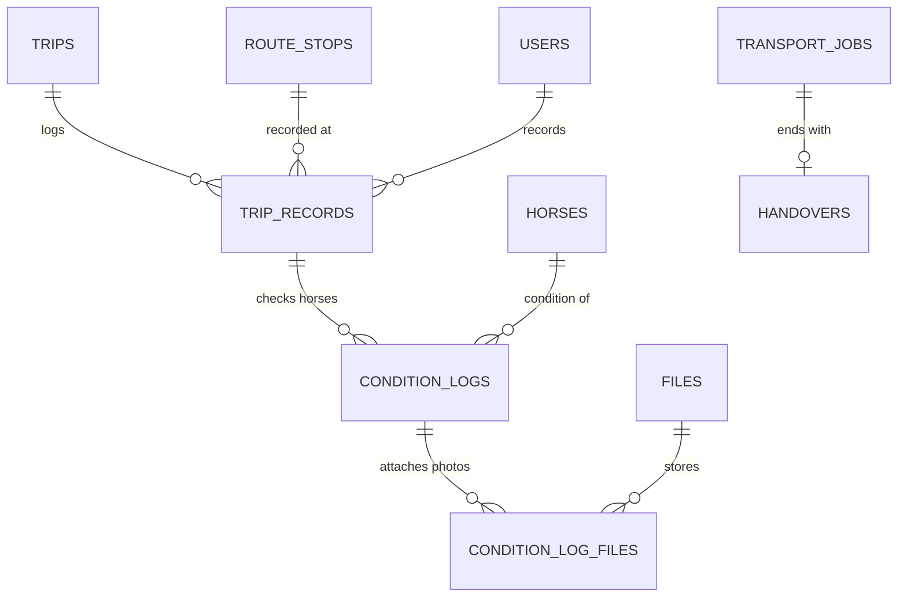

**`trip_records`** (append-only): the trip's log, kept by its escorts, and the only source of positions. A `DEPARTED` record is refused unless every job with horses `ON_TRIP` on the trip is `CLEARANCE_READY` (trigger, BR-F2-03). A condition log names its horse, so each customer's view and photos are filtered to their own horses.

| Column | Type | Rule |
|---|---|---|
| `trip_id` | → `trips` not null | |
| `route_stop_id` | → `route_stops` | The checkpoint, if any. |
| `kind` | varchar(20) | `LOADED`, `DEPARTED`, `ARRIVED_AT_STOP`, `CLEARED_BORDER`, `HELD`, `LEFT_STOP`, `CONDITION_CHECK`, `ACCEPTED_BY_AIRLINE`, `FLIGHT_DEPARTED`, `FLIGHT_LANDED`, `RELEASED_BY_AIRLINE`, `DELIVERED`, `HANDED_OVER`, `NOTE`. The flight kinds are recorded by the flying groom or by staff from the airline's notice. |
| `occurred_at` | timestamptz not null | The cab's clock. |
| `received_at` | timestamptz not null default now() | The server's clock. The gap shows records sent late from the cab ("1 record waiting to send"). |
| `client_ref` | uuid unique | Generated on the tablet, so a record re-sent after a lost connection is stored once. |
| `recorded_by` | → `users` | Driver or groom. |
| `channel` | varchar(12) | `CAB_TABLET`, `WEB`. |
| `text` | varchar(500) | "Cleared Vietnam export and Cambodia entry at Mộc Bài – Bavet." |

Index `(trip_id, occurred_at)`.

**`condition_logs`** (append-only): `trip_record_id`, `horse_id`, `condition` (`SOUND`, `WATCH`, `CONCERN`), `drinking boolean`, `eating boolean`, `note`. Unique `(trip_record_id, horse_id)`.

**`condition_log_files`**: `(condition_log_id, file_id)`, the photos attached to one horse's condition entry. A file can be attached once; links are append-only and follow the same ownership checks as other job files.

**`handovers`**: one per job

| Column | Type | Rule |
|---|---|---|
| `job_id` | → `transport_jobs` unique | |
| `delivered_at` | timestamptz | From the `DELIVERED` trip record. |
| `receiving_name` | varchar(120) | "Sophea, receiving groom". |
| `handed_over_at`, `handover_record_id`, `receiver_confirmed` | timestamptz, → `trip_records`, boolean | The handover (US-F6-01): when, the `HANDED_OVER` record with each horse's condition and photos, and the receiver's confirmation on the tablet. All three with the receiver's name together (`handovers_handed_over_check`); fixed once set (trigger `handovers_handover_fixed`). |
| `confirm_due_at` | timestamptz | Within 2 days. Paused while an incident is open. |
| `customer_outcome` | varchar(20) | `CONFIRMED_SOUND`, `PROBLEM_REPORTED`. |
| `discrepancy`, `discrepancy_incident`, `accepted_by_default` | varchar(1000), → `incidents`, boolean | The customer's answer (US-F6-02): what they said went wrong and the `CUSTOMER_REPORT` incident it opened; or no answer by `confirm_due_at`, taken as accepted. An answer needs `confirmed_at`, a discrepancy its text (`handovers_outcome_check`). |
| `confirmed_by`, `confirmed_at` | | |
| `late_minutes` | integer | With an arrival window: minutes after `window_end`, minus minutes the clock was stopped. Null when there's no window. |
| `penalty_amount` | numeric(14,2) | ⌈late_minutes ÷ 60⌉ × pct × total, capped. Credited as a line on the final invoice (section 13A). |

---

## 12. Domain J: incidents

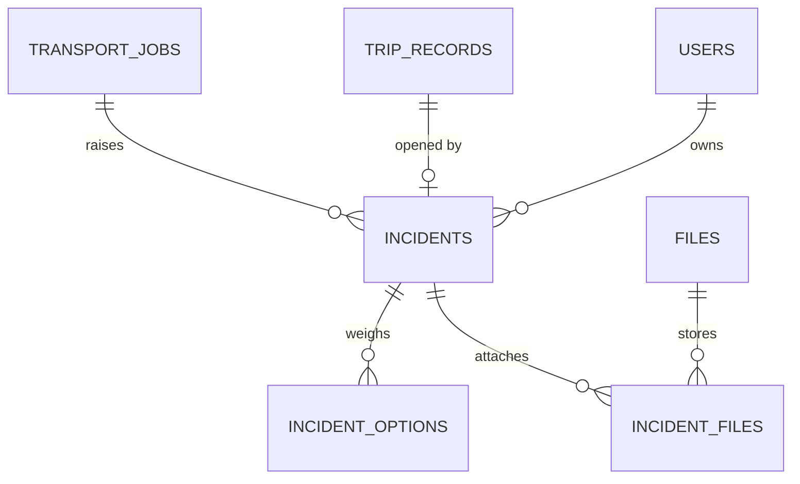

**`incidents`**

| Column | Type | Rule |
|---|---|---|
| `job_id` | → `transport_jobs` not null | |
| `kind` | `IncidentKind` | `HELD`, `CUSTOMER_REPORT`, `WELFARE` (a horse medical incident), `VEHICLE` (a breakdown), `TRAFFIC` (a prolonged jam), `OTHER`, `LATE_ARRIVAL`, `WEATHER`, `BORDER_CONGESTION`. The cab reports `WELFARE`, `VEHICLE`, `TRAFFIC` and `OTHER` (US-F5-01); a coordinator's delay alert is `TRAFFIC`, `WEATHER` or `BORDER_CONGESTION` (US-F5-04). |
| `source` | varchar(12) | `CAB`, `CUSTOMER`, `STAFF`. |
| `trip_record_id` | → `trip_records` | The escort's record, quoted verbatim. |
| `owner_id` | → `users` not null | The logistics manager. Every incident has one owner. |
| `status` | varchar(12) | `OPEN`, `DECIDED`, `RESOLVED`. |
| `summary` | varchar(500) | What happened, as the reporter wrote it. |
| `location` | varchar(200) | Where it happened, as written. |
| `horse_id` | → `horses` | The horse it concerns; required for a horse medical incident. The incident is raised on that horse's job. |
| `reported_by` | → `users` | The escort on the cab, or staff. |
| `client_ref` | uuid, unique when set | The tablet's reference: a resend returns the incident already opened. |
| `opened_at`, `reply_due_at` | timestamptz | A customer report is answered within 2 hours. |
| `stops_clock` | boolean | True for an authority hold or a welfare stop: the arrival-window clock and the handover deadline pause while it is open. |
| `clock_stopped_from`, `clock_stopped_until` | timestamptz | |
| `proposed_option_id`, `proposed_by`, `proposed_at`, `proposal_note` | | The option proposed for the manager's approval (US-F5-02), and why; cleared when the manager sends it back. |
| `decided_option_id` | → `incident_options` | |
| `decided_by`, `decided_at`, `decision_note` | | The logistics manager's approval of the proposed option (US-F5-03). |
| `customer_message` | varchar(1000) | What the customer was told, sent as written. |
| `charge_customer` | boolean | Whether the customer pays the decided option's extra cost. |
| `route_plan_id` | → `route_plans` | The confirmed route version the decision gave the trip, if it changed the route or the times. |
| `eta_at` | timestamptz | The arrival the latest delay alert announced (US-F5-04). |
| `resolution`, `closing_note` | varchar(300), varchar(1000) | How it ended and the closing note; both required when `RESOLVED` (`incidents_resolution_check`, US-F5-05). |
| `resolved_at`, `resolved_by` | timestamptz, → `users` | When and which logistics manager closed it; required when `RESOLVED`. |

**`incident_options`**: `incident_id`, `title`, `description`, `facts jsonb` (time, documents, the horse, cost), `position`, `extra_cost numeric(14,2)` (≥ 0, in the job's quotation currency), `delay_minutes` (≥ 0, added to the arrival), `changes_route` (approving it gives the trip a new route version), `created_by`. The coordinator records them and proposes one (US-F5-02).

**`incident_files`**: `(incident_id, file_id)`, the photos with a report.

**`incident_options`, leaving a moving trip (US-F5-06)**: `leaving_kind LeavingKind null` (`UNLOAD`, `SECOND_VEHICLE`, `RETURN_TO_ORIGIN`, `LEAVE_IN_CARE`), `leaving_place` (required for unload and care), `vehicle_id` (required for a second vehicle), `customer_pays` (who bears the cost as proposed), and the horses that leave in `incident_option_horses (option_id, horse_id)`. `incidents.new_trip_id` is the trip they moved to. `IncidentKind` gains `LATE_ARRIVAL`, another job pushed past its window by a decision.

**`job_charges`**: `job_id`, `incident_id null` (unique when set), `description`, `amount numeric(14,2) > 0` in the job's quotation currency, `created_by`. A cost the final invoice adds beyond the quotation, such as an approved incident option the customer pays (US-F5-03); the final invoice turns each into an `ADJUSTMENT` line.

---

## 13. Domain K: notes and notifications

| Table | Columns | Rules |
|---|---|---|
| `notes` | `club_id`, `request_id null`, `job_id null`, `checklist_item_id null`, `topic` (`DOCUMENTS`, `DATES_PRICE_CHANGES`, `TRIP`, `ROUTE`, `OTHER`), `routed_role`, `assignee_id`, `subject`, `body`, `attached_file_id null`, `created_by`, `reply_due_at`, `status` (`OPEN`, `ANSWERED`, `CLOSED`) | Check: at least one of `request_id`, `job_id` is set. `attached_file_id` is one optional file the customer attached (→ `files`), counted as attached so the orphan cleanup keeps it. The topic decides who answers (documents → transport specialist; dates, price or changes, and a route we don't run → logistics manager). Never a free chat. |
| `note_replies` | `note_id`, `author_id`, `body` | |
| `notifications` | `user_id`, `kind` (`NotificationKind`), `title`, `body`, `entity_type` (`NotificationSubject`: `TRANSPORT_REQUEST`, `QUOTATION`, `TRANSPORT_JOB`, `AUTHORITY_SUBMISSION`, `DOCUMENTS`, `TRIP_TRACKING`, `INCIDENT`), `entity_id`, `entity_code`, `link_path`, `dedupe_key null`, `read_at`, `emailed_at` | The bell reads from it (US-00-07); sidebar badges count their own queues, not notifications. Every row links to its record: `entity_code` is the code the row shows (`REQ-2026-0031`), `link_path` the page this recipient opens it on, resolved when the row is written. Index `(user_id, read_at)`. Partial unique index `(user_id, dedupe_key) where read_at is null and dedupe_key is not null`: a repeated notice bumps the unread row instead of stacking. A notification is a pointer, never evidence; the audit log is. |

---

## 13A. Domain M: invoices and payments

Brought into scope on 2 Oct 2026. Kept small: an invoice is the accepted quotation settled against what actually happened, with no tax engine, dunning or accounting export.

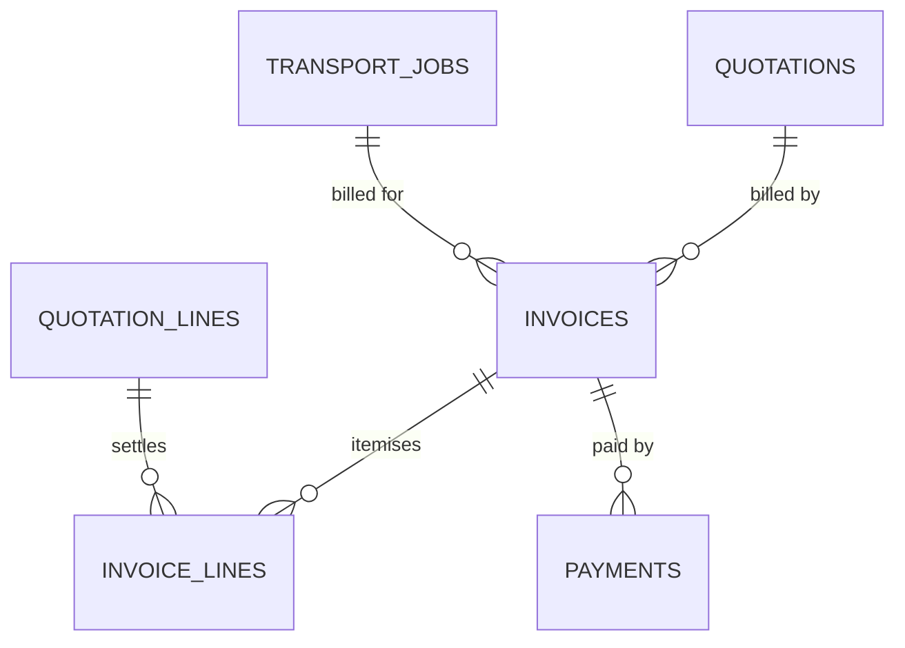

Two invoices per job, both generated, never typed:

1. **Deposit invoice**, issued when the customer accepts: one line, `deposit_pct` of the quotation total.
2. **Final invoice**, issued after the customer confirms handover (or the 2-day confirmation window ends):
   - every fixed line of the accepted quotation, unchanged;
   - every estimated line with its actual quantity (waiting time 3 h instead of 2 h);
   - the late-arrival penalty as a credit line, when there is a window and the horses were late;
   - minus the deposit already paid.

**`invoices`**

| Column | Type | Rule |
|---|---|---|
| `code` | varchar(16) unique | `INV-2026-0041`, from `code_counters`. |
| `kind` | varchar(10) | `DEPOSIT`, `FINAL`, `CREDIT_NOTE`. |
| `quotation_id` | → `quotations` not null | The accepted version; its currency is the invoice currency. |
| `job_id` | → `transport_jobs` | Null for the deposit invoice (the job is created at approval, after acceptance). |
| `club_id` | → `clubs` not null | |
| `status` | varchar(16) | `DRAFT`, `ISSUED`, `PARTIALLY_PAID`, `PAID`, `VOID`. |
| `issued_by`, `issued_at`, `due_on` | | Due: 7 days after issue. |
| `subtotal`, `tax_pct`, `tax_amount`, `total`, `amount_paid` | numeric | `tax_pct` is a single rate (e.g. Vietnam VAT) set per invoice; `amount_due = total - amount_paid` is computed. |
| `voided_at`, `void_reason` | | An issued invoice is never edited: it is voided and replaced, or corrected with a credit note. |
| `corrects_invoice_id` | → `invoices` | For a credit note. |

Partial unique index: one non-void `DEPOSIT` and one non-void `FINAL` invoice per quotation.

**`invoice_lines`**: `invoice_id`, `position`, `quotation_line_id null`, `kind` (`QUOTED`, `ACTUALISED`, `DEPOSIT`, `DEPOSIT_DEDUCTION`, `LATE_PENALTY_CREDIT`, `ADJUSTMENT`), `description`, `quantity`, `unit_rate`, `amount` (negative for credits and deductions), `note` (required for `ACTUALISED` and `ADJUSTMENT`: "Flight delayed: waited 3 h, quoted 2 h").

**`payments`**: `invoice_id` not null, `amount`, `method` (`BANK_TRANSFER`, `CARD`), `reference`, `received_at`, `recorded_by`, `status` (`PENDING`, `CONFIRMED`, `REFUNDED`). Recording a confirmed payment updates `invoices.amount_paid` and the status in the same transaction. Online card payment is not designed; staff record bank transfers by hand, like authority steps.

Screens: the customer's **Tracking · Invoice** page (drawn 2 Oct 2026) under the request (lines, what changed from the quotation and why, amount due, bank details), and the logistics manager's **Invoices** list with its **Record payment** state (drawn 21 Oct 2026): overdue first, then by due date; the amount, method, bank reference and date of each payment against one invoice; a recorded payment is never edited, only reversed with a refund entry. The Quotation's "After you accept" panel and the Delivered and Closed pages link to the customer's invoice.

## 14. Domain L: audit and codes

**`audit_log`** (append-only, BR-F1-08)

| Column | Type | Rule |
|---|---|---|
| `occurred_at` | timestamptz not null | |
| `actor_id` | → `users` | Null for the system and for someone not signed in. |
| `actor_label` | varchar(160) | "Saigon Turf Club", "System", "Not signed in", kept even if the user is later renamed. |
| `actor_role` | varchar(30) | |
| `channel` | varchar(12) | `WEB`, `CAB_TABLET`, `SYSTEM`. |
| `device_recorded_at` | timestamptz | For cab records sent later ("16:12"). |
| `action` | varchar(60) | Machine code, e.g. `DOCUMENT_REJECTED`, `QUOTATION_ISSUED`, `CATALOG_PUBLISHED`. |
| `summary` | varchar(500) | The sentence the log shows. |
| `entity_type`, `entity_id` | | |
| `entity_code` | varchar(20) | `REQ-2026-0193`, `CBRT-2026-041`, `Catalog KH v8`, `EF-015`. What the search box matches. |
| `before`, `after` | jsonb | What changed. |
| `reason` | varchar(500) | As written by the person. |

Indexes: `(occurred_at desc)`, `(entity_code, occurred_at desc)`, `(actor_id, occurred_at desc)`, `(action)`. Only the logistics manager role is granted `SELECT`; nobody is granted `UPDATE` or `DELETE`.

**`code_counters`**: `prefix` (`REQ`, `Q`, `CBRT`, `EF`, `INV`, `TRP`), `year smallint`, `last_value int`. Primary key `(prefix, year)`. A row lock (`select … for update`) issues the next code inside the creating transaction.

---

## 15. Business rules → where they are enforced

| Rule | Enforced by |
|---|---|
| BR-F1-01 lead time (21 / 3 days) | Application, from the newest published regulation version of the destination and every transit country (`lead_time_days`), or the country's `domestic_lead_time_days`; express override columns on the request. |
| BR-F1-02 one route and one window per request | Structure: route and window are columns of the request, not of each horse. |
| BR-F1-03 quotation valid 7 days | `valid_until`; a scheduled job sets `EXPIRED`. |
| BR-F1-04 only the logistics manager approves or rejects | Application (role check); `approved_by` must hold that role (trigger). |
| BR-F1-05 one job per approved request, CBRT code | `transport_jobs.request_id unique`, `code unique`, `code_counters`. |
| BR-F1-06 price and horses locked after approval | Trigger on `request_horses`; accepted quotation is immutable. |
| BR-F1-08 audit every status change | `audit_log`, written in the same transaction. |
| BR-F2-01 checklist from pinned catalogs | `job_regulation_pins`, `checklist_items.regulation_rule_id`. |
| BR-F2-02 valid on departure and arrival + buffer | Validity engine, result in `checklist_items.validity`. |
| BR-F2-03 clearance gate | Check on `transport_jobs`; trigger on `DEPARTED` trip records. |
| BR-F2-04 only the specialist reviews | Application role check; `reviewed_by` role (trigger). |
| BR-F2-05 versions never overwritten | `document_versions` append-only. |
| BR-F2-07 rejection reason visible | Check: `review <> 'REJECTED' or reject_reason is not null`. |
| Quotation override needs a reason | Check on `quotation_lines`. |
| Arrival window ≥ 3 h, road, private trailer | Check on `transport_requests`. |
| No vehicle double-booking | Exclusion constraint on `vehicle_bookings`. |
| An issued invoice is never edited | Application; void and replace, or a credit note (`corrects_invoice_id`). |
| One deposit and one final invoice per quotation | Partial unique indexes on `invoices`. |
| Old route plans stay visible | `route_plans` versions are never deleted; `SUPERSEDED` keeps the reason. |

---

## 16. Screen → table map

| Screen | Reads | Writes |
|---|---|---|
| Request · 1–4 (Horses, Route & dates, Service, Review) | `horses`, `corridors`, `rate_*` (estimate) | `transport_requests`, `request_horses` |
| Request review (staff) | `transport_requests`, `request_revisions`, `audit_log` | status, `info_required_note`, override |
| Quotation builder | `rate_*` (pinned), `request_horses` | `quotations`, `quotation_lines` |
| Quotation (customer) | `quotations`, `quotation_lines`, `rate_fee_bands` | accept or decline; creates the deposit `invoices` row |
| Tracking · Invoice (customer) | `invoices`, `invoice_lines`, `payments`, `quotation_lines` | — |
| Invoices, Invoices · Record payment (logistics manager) | `invoices`, `payments`, `clubs` | `payments` (status `CONFIRMED`), `invoices.amount_paid` and status |
| Tracking pages, Home | `transport_requests`, `transport_jobs`, `checklist_items`, `trip_records`, `audit_log` | — |
| Clearance checklist, All documents | `checklist_items`, `document_versions` | due dates, planned departure |
| Document upload / review | `checklist_items` | `document_versions`, `files` |
| Authorities | `authority_submissions`, `authorities` | submissions, references, results |
| Regulation / Rate catalog | `regulation_*`, `rate_*` | draft rows, publish |
| Load plan | `vehicles`, `vehicle_stalls`, `horses` | `load_plans`, `load_plan_stalls` |
| Route plan | `route_plans`, `route_stops`, `route_legs`, `flights`, `transport_jobs` (window) | route plan, confirm, re-plan |
| Tracking (customer route panel) | every confirmed and superseded `route_plans` version | — |
| Coordinator · Trip, In transit | `trip_records`, `condition_logs`, `route_stops` | — |
| Escort cab screens | `route_stops`, `load_plan_stalls` | `trip_records`, `condition_logs` |
| Delivered, Closed | `handovers`, `condition_logs` | customer confirmation |
| Incidents, Report a problem | `incidents`, `incident_options`, `trip_records` | `incidents`, decision, `incident_files` |
| Ask a question, Customer notes | `notes`, `note_replies` | both |
| Users & roles, Access | `users`, `roles`, `account_tokens` | users, invites, tokens, `sign_in_attempts` |
| Audit log | `audit_log` | — |

---

## 17. Decisions and open questions

Decided on 2 Oct 2026:

1. **One account per club.** Enforced by a unique index on `users.club_id`; removable later.
2. **Air trips.** Routes are stops joined by legs (`route_legs`); an air leg carries a `flights` row. Road screens keep working unchanged, and an air trip screen can be drawn later from the same stop list.
3. **Invoices are in scope** (section 13A): a deposit invoice and a final invoice per job, payments recorded by hand. This changes the quotation spec's "out of scope: invoicing and settlement".
4. **The customer sees every confirmed route version**, the superseded ones with their reason.

Still open:

5. **Penalty clock.** `incidents.stops_clock` pauses the window for authority holds and welfare stops; waiting for the teacher's confirmation.
