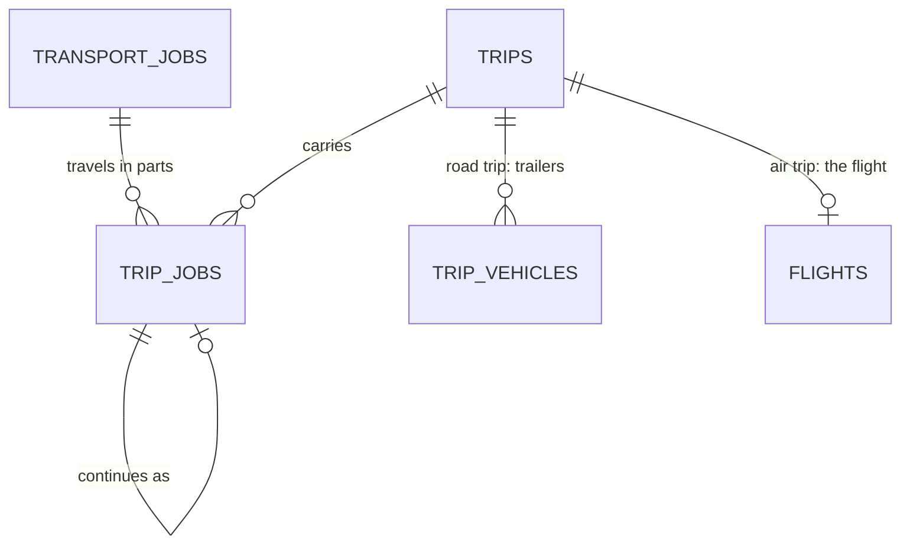

# One job, several trips: road, air, road

Status: built (US-F3-16, #206), 25 Oct 2026; reworked by US-F3-21 (#269), 27 Oct 2026: the coordinator builds the journey one trip at a time (see [Coordinator-built journeys](#coordinator-built-journeys-us-f3-21)). US-F3-22 (#277) makes a scheduled quarantine part of the journey (see [A journey through a quarantine](#a-journey-through-a-quarantine-us-f3-22)). See [As built](#as-built) for where the build differs from the plan below. Builds on `docs/shared-trips-design.md`, which already lets a job span trips after an incident (US-F5-06, `trip_jobs`).

## Why

A job that flies is really three moves: trailers take the horses from their stables to the departure airport, the airline flies them, and after release at the arrival airport (often after days in import quarantine) other trailers take them to their stables, sometimes across one or more borders. Today one job is planned as one trip, so the same `trip_vehicles` convoy is booked from the first pickup to the final delivery, as if the trailers flew with the horses. The trailers after landing are a different set, often on a different date and sometimes with a local partner's crew.

## Decisions (agreed 25 Oct 2026)

| Question | Decision |
| --- | --- |
| Shape | **A chain of trips per job:** one trip per leg of the journey, e.g. road → air → road. The job stays the commercial and legal unit. |
| The flight | **Its own trip.** An air trip's flight plays the part a trailer plays on a road trip: the flight number takes the vehicle's place, so no rule is broken by a trip that has no trailer. |
| Who makes the chain | **The fleet coordinator, while planning,** except for a request that goes by way of hubs (US-F1-09): its approval puts the job on the chain its route names, the domestic leg to the hub, the corridor that crosses the border, and the leg from the hub. Otherwise approval puts the job on one trip and the coordinator adds the next trip on the Route tab. |
| Corridors | **Every trip has a catalog corridor of its own mode.** The air trip uses an air corridor ("AIR BKK → HKG"); each road trip a road corridor ("RD VTE → BKK", "RD HKG → Sha Tin"). Sharing a trip with other jobs keeps working, because sharing is "same corridor". |
| Price | **Unchanged.** The quotation already covers door to door (ground lines and air). Splitting the journey into trips is planning only, like sharing; invoices stay per job. |

## The model

An example: four horses from Vientiane to Sha Tin, two trailers each side.

| Trip | Corridor | Carrier | From → to | Ends with |
| --- | --- | --- | --- | --- |
| TRP-2026-041 | RD VTE → BKK | 2 trailers (convoy) | Vientiane stable → BKK cargo terminal, border at Nong Khai | `HANDED_ON` at the airport |
| TRP-2026-042 | AIR BKK → HKG | Flight CX 2071 | BKK → HKG | `HANDED_ON` at release |
| TRP-2026-043 | RD HKG → Sha Tin | 2 trailers (convoy) | HKG quarantine → Sha Tin stables | `DELIVERED`, then handover |

Each trip can still be shared with other jobs on its own corridor, and each is planned, signed off, departed and logged on its own. Each road trip takes only a vehicle that works its corridor and is in the country it starts in (US-F7-01), so the road leg after a flight needs a vehicle based at the arrival end, or one whose last trip ended there; the air trip carries no vehicle and isn't checked.

### Changes

| Table | Today | Becomes |
| --- | --- | --- |
| `trips` | `corridor_id`, any mode; one trip per job before departure | Unchanged columns. The trip's mode is its corridor's. A road trip carries trailers (`trip_vehicles`, load plans, drivers, grooms); an air trip carries one flight and no trailers. |
| `trip_jobs` | One row per part of a job on a trip | Adds `next_trip_job_id null`, the part it hands on to, so the chain is explicit and survives an incident moving horses. |
| `trip_horses.status` | `ON_TRIP`, `MOVED`, `DELIVERED`, `LEFT_IN_CARE` | Adds `PLANNED` (on a later trip of the chain, not loaded yet) and `HANDED_ON` (left this trip for the next trip of the chain). The "one trip at a time" index (`status = 'ON_TRIP'`) is unchanged, so a horse is `PLANNED` on trip 3 while it is `ON_TRIP` on trip 1. |
| `route_stops.kind` | `PICKUP`, `DELIVERY`, … name the job | Adds `TRANSFER`, which names the job like `PICKUP` and `DELIVERY` do: the stop where that job's horses leave this trip for the next one. A trip that hands on ends at a `TRANSFER`; the next one starts at a `PICKUP` at the same place. `DELIVERY` (and so the handover) only exists on the last trip of the chain. |
| `flights` | One per air `route_leg` | Unchanged. On an air trip the flight is the carrier; its `flight_allocations` are the per-job "load plan" (stall positions, waybill). |
| `crew_assignments` | Trailer crew, or flight crew (no trailer) | Unchanged. An air trip has only flight crew; a road trip only trailer crew. |
| `vehicle_bookings` | One per trailer for the trip's span | Unchanged, and now right: each road trip books its own trailers for its own dates, so the onward trailers aren't blocked during the flight and quarantine. |

The "a trip keeps at least one trailer" rule (`LoadPlanService`) becomes **a trip keeps at least one carrier**: a trailer on a road trip, the flight on an air trip.

## Rules

**Adding the next trip.** On a job's Route tab, before the job's current trip departs, the coordinator picks a stop on the trip's draft route (an `AIRPORT_OUT`, `AIRPORT_IN` or `QUARANTINE` place) and "continues on another trip". The app:
1. turns that stop into a `TRANSFER` for the job and drops the job's stops after it from this trip (the trip's route reopens as a new draft version);
2. creates the next trip with a corridor of the next mode starting at that place, chosen by the coordinator from the catalog, or puts the job on an existing trip on that corridor (the joining rules of shared trips apply);
3. adds the job's horses to it as `PLANNED`, with a `PICKUP` at the transfer place and the job's `DELIVERY` (or another `TRANSFER`) at the end.

Removing a trip from the chain is the reverse, before either trip departs.

**Handing on.** The record that ends trip N at its `TRANSFER` stop (`ACCEPTED_BY_AIRLINE` when a road trip leaves the horses with the airline, `RELEASED_BY_AIRLINE` when the air trip lands them) marks the job's horses `HANDED_ON` there and `ON_TRIP` on trip N+1. The job's part on trip N is done; the trip is done when no job is left on it, as today.

**Departure.** Each trip departs on its own and keeps the clearance gate: every job with horses `ON_TRIP` must be `CLEARANCE_READY`. The exception is a domestic leg before the border (US-F2-13): a trip that stays in one country and hands on, down the chain, to one that crosses a border departs, and is signed off, before the dossier clears, because the export checks happen where the move leaves the country. The job itself departs only with the trip that crosses the border: until then its `departed_at` stays empty, its stage doesn't move to Trip, and its documents stay open and are checked against that trip's planned departure (the job's own until that trip's route is confirmed). Trip N+1 can't depart before its horses are handed on to it. Planned times must follow each other: trip N+1's pickup at or after trip N's transfer, plus quarantine (the `QUARANTINE` stop's planned stay).

**Delivery and handover.** Only the last trip has the job's `DELIVERY`; handover, the late-arrival penalty and the final invoice work as today. An arrival window (road only, private trailer) applies to the last trip's delivery.

**Incidents.** Unchanged: an incident can still move horses to a new trip. The new trip takes the moved horses' place in the chain (`next_trip_job_id` is repointed), so the onward trips still follow.

## Screens

- **Job › Route / Load plan / Crew tabs:** a journey rail to the left of the tabs (as built; DESIGN.md, Job page), first planned as a trip switcher above the tabs ("1 · Road VTE → BKK · 2 · Air BKK → HKG · 3 · Road HKG → Sha Tin"). Every job-scoped endpoint that today resolves "the job's current trip" (`TripRepository.findCurrentByJobId`, used by about 38 call sites in 12 services) takes an optional `tripId`, defaulting to the current trip. On an air trip the Load plan tab shows the flight's allocations instead of trailers.
- **Customer tracking:** one timeline across the job's trips, in chain order, still without trip codes or other clients.
- **Fleet calendar:** unchanged; each road trip's bookings show on their own dates.

## As built

- **No `seq` column.** The order of a journey follows `next_trip_job_id`; the job's parts are listed in that order. The column isn't unique: an incident that moves some horses off a trip of the journey links their new trip to the same next trip, so they join the others there.
- **Handing on is the delivery at the transfer.** On a part that hands on, `ARRIVED_AT_STOP` at the `TRANSFER` stop and then `DELIVERED` hand the horses on to the next trip instead of delivering the job; a `HANDED_OVER` record there is refused. The airline records (`ACCEPTED_BY_AIRLINE`, `RELEASED_BY_AIRLINE`) stay entries in the log.
- **Where a journey splits.** Only at an `AIRPORT_OUT`, `AIRPORT_IN` or `QUARANTINE` stop before the job's delivery. A stop shared with other jobs on the trip stays, and the job's `TRANSFER` is added after it. The next trip's pickup is planned at the stop's time plus its stay.
- **Times follow each other.** Confirming a trip's route checks it against its neighbours in the journey: the job's pickup can't come before the trip before has the horses ready (its `TRANSFER` time plus the planned stay there, or the stay of the stop just before it at the same place when the transfer was added beside a shared stop), and its `TRANSFER` plus stay can't come after the next trip's pickup. The neighbour's draft is read before its confirmed route, so the coordinator moves the later trip first, then the earlier one.
- **Joining an existing trip** is the shared-trip flow on the later trip (its Load plan tab), not part of "continue on another trip". On a later trip of a journey its days are that trip's own pickup moved by the corridor's flex days, and never before the day the trip before has the horses ready.
- **Air trips.** A trip whose confirmed route has no road leg is signed off without load plans or drivers; its flight crew is checked as for any flight. The airports a flight joins on are read from its air legs, not from the `AIRPORT_OUT` and `AIRPORT_IN` stops.
- **Incidents branch the journey.** Horses moved to a second vehicle, or unloaded to continue later, keep going: their new trip hands on to the journey's next trip, where they join the others. Horses left in care, or returned to their origin, leave the journey: they come off every later trip (out of their stalls there), a later trip with none of the job's horses left drops out of the chain, and it releases its trailers and crew when nobody else rides it, or reopens without the job's stops when others do.
- **Every job-scoped planning endpoint** takes `?trip=`; the job page keeps the chosen trip in its URL.
- **Crew are booked per trip.** A crew member is busy for each trip's own planned span (its route's first planned time to its last, plus that stop's stay), not for the job's whole journey: a groom can ride the trailer to the airport and fly with the horses on the next trip.
- **The customer's timeline.** Without `?trip=`, the customer's tracking view of a journey merges every trip's own view in chain order: one numbered list of stops (a later trip's pickup at the transfer place is left out), every record in the order it happened, every trip's flights, and the job's own status and times. Opening one trip shows only that trip, with a way back to the whole journey. A delivery recorded at a `TRANSFER` reads "Handed on to the next trip", and a trip that handed on shows "Handed on".

## Coordinator-built journeys (US-F3-21)

US-F3-21 replaces the way a chain is made. The rest of this document still holds: a journey is a chain of trips, each with its own corridor, carrier, dates, crew and bookings, handed on at `TRANSFER` stops.

- **Approval makes no trip.** The job's Trip tab opens with an empty journey, and the fleet coordinator adds its first trip. The chain the quoted route used to give a request by way of hubs (US-F1-09) is gone; the quoted route is only a guide, with a Warn line where the journey leaves it, since the price was worked out on it.
- **Add trip** (`POST /staff/jobs/{id}/journey/trips`) puts a trip on any catalog corridor touching the city the journey has reached (the origin's city first, then where the last trip ends), read from that city. The direction is stored on the trip (`trips.reversed`, V35), not worked out from the chain, because a shared trip runs one way for every job on it; joining checks it.
- **Where the horses change trips.** A trip that ends short of the destination city ends with a `TRANSFER` at that city's cargo terminal or airport (else a quarantine station, else the request's own place there, else any place there); the next trip starts with a `PICKUP` at the same place. The trip that reaches the destination city ends with the `DELIVERY`. Route confirmation expects a `TRANSFER` at the end of a trip short of the destination city even before the next trip exists.
- **A flight** is added with its route confirmed at once, cargo terminal to cargo terminal by air, with no times. Setting its flight (`PUT /staff/jobs/{id}/journey/trips/{tripId}/flight`) confirms a new version with the airport-out stops at the departure time and the airport-in stops at the arrival, so the checks against the trips before and after run then. It has no load plan and no route editor.
- **Take off** (`DELETE /staff/jobs/{id}/journey/trips/{tripId}`) removes only the last trip, before it departs; the only trip leaves the job with none. A trip nobody else rides is deleted with its route, load plans, bookings and crew (database cascades); a shared one reopens without the job.
- **Splitting a route at a stop** ("continue on another trip") is removed.
- **Sign-off** is refused while the journey ends short of the destination city, and on a flight without its flight and times.
- **A job with no trip** shows a locked gate ("No trip planned yet"), its documents are checked against the request's departure date, it isn't listed on the trip boards, and its planning endpoints answer `NO_TRIP`, "Add its first trip on the Trip tab".
- **The job page** has three tabs, Trip, Clearance and Authorities (DESIGN.md, Job page); the journey rail lives in the Trip tab.

## Drafted from the quote (US-F3-22)

The coordinator can still build a journey by hand, but the empty Trip tab's main action drafts it from the quoted route (`POST /staff/jobs/{id}/journey/draft`, refused once the job has a trip):

- **Trips:** one per corridor of the quote (the leg to the hub, the corridor, the leg from the hub), each added with Add trip's rules, so the directions and hand-over places are the same as by hand.
- **Road routes** become drafts. The pickup comes first. Then, country by country in the trip's direction, the catalog's welfare places in that country (one per interval of driving) and the border crossing out of it. The transfer or delivery comes last.
  - The catalog has no positions, so the country is the only guide to which welfare places lie on the way. A drive that needs more welfare stops than it found says so in the route's draft reason.
- **Times:**
  - The first trip starts on the request's departure date at the planned start hour.
  - The corridor's distance at the planned speed is shared equally between the legs. Each border and welfare stop adds its stay, and a transfer before a flight adds the wait at the cargo terminal.
  - A trip starts when the trip before has the horses ready.
  - A flight's hand-over at the arrival airport stays for the release time. A trip after a flight stays untimed until the flight's times are set.
- **Planning settings** (`PLAN_*` rate policies, V36, versioned with the catalog): start hour 6, 60 km/h, a welfare stop every 4 h for 45 min, 90 min at a border, 4 h at the terminal before a flight, 3 h release after landing. A version that doesn't set one uses that default (`PlanningDefaults`).
- **Nothing is confirmed.** The coordinator reviews each draft and confirms it, and the checks between trips run then. Changing an earlier trip doesn't move the later ones; confirming refuses a conflict.

## A journey through a quarantine (US-F3-22)

A quarantine the transport specialist schedules on the Authorities tab is part of the journey: one trip takes the horses to the station, they wait there, and the next trip collects them after it. An example, four horses from Đại Nam Racecourse (Ho Chi Minh City) to Sha Tin, with a 14-day pre-export quarantine at the racecourse's isolation barn, 11–25 Nov (Hong Kong asks for at least 14):

| Trip | Corridor | From → to | Ends with |
| --- | --- | --- | --- |
| TRP-2026-021 | RD HCM local | Đại Nam Racecourse → Đại Nam Racecourse isolation barn | `TRANSFER` at the station, by 11 Nov |
| TRP-2026-022 | RD HCM local | Đại Nam Racecourse isolation barn → TCS cargo terminal, Tân Sơn Nhất (SGN) | `TRANSFER` at the cargo terminal, from 25 Nov |
| TRP-2026-023 | AIR SGN → HKG | Tân Sơn Nhất → Hong Kong | `TRANSFER` at Cathay Cargo Terminal (HKG) |
| TRP-2026-024 | RD HKG → Sha Tin | Hong Kong → Sha Tin Racecourse stables | `DELIVERY` |

- **Local corridors.** The catalog has a same-city road corridor for each city horses change carrier in ("RD HCM local", "RD PNH local", "RD HKG local"), with a flat per-shipment rate. Add trip offers it like any corridor touching the city, so a stable → station or station → airport move is a trip of its own, with a corridor, a price line and a vehicle check.
- **Ending a trip at the station.** While the job has a quarantine scheduled in the city a road trip ends in, and the trip doesn't deliver, Add trip offers ending it at that quarantine station (`quarantinePlaceId` on `POST /staff/jobs/{id}/journey/trips`; the corridors list carries each corridor's `quarantineStations`). The trip ends with a `TRANSFER` at the station, and the next trip starts with a `PICKUP` there; from there it ends where horses change trips, as any trip short of the destination city does. Left empty, the trip ends where horses change trips. The server refuses a station on a trip that delivers (`QUARANTINE_NOT_ON_WAY`) or one where the job has no quarantine in that city (`NO_QUARANTINE_THERE`).
- **A quarantine scheduled after the journey is planned.** Once the journey reaches the destination city no trip can be added after it, so a station no trip reaches is routed into the journey instead. Beside the "no trip takes the horses there yet" warning, the Trip tab offers "Route TRP-… via <station>" (`POST /staff/jobs/{id}/journey/quarantines/{placeId}`; the job detail's `quarantineDetours` lists the stations it can be offered for). The first road trip of the journey, not yet departed, that ends in the station's city gets a new draft route version that hands the horses on at the station (`TRANSFER`), and a new local run (`findLocalRun`) is inserted after it, from the station to where that trip used to leave the horses, with the same kind (`TRANSFER`, or `DELIVERY` when it delivered). The trips after it don't change. Both routes are drafts to plan and confirm. It is refused when no road trip ends in that city (a flight lands there, or the trip only passes through: `QUARANTINE_NOT_ON_WAY`), or the city has no local run (`NO_LOCAL_RUN`); then the trips after the quarantine are taken off and added again by way of the station.
- **No `QUARANTINE` stop in the route editor.** The stop kind stays for routes saved with it, but the editor no longer offers it: a stay at a stop keeps the trailer and crew booked for the whole quarantine, and the quarantine's checks and warnings only see a `TRANSFER` into the station and a `PICKUP` out of it.
- **The dates bind the trips either side.** Route confirmation (`QuarantineRules`) checks each trip of the job against every quarantine not yet completed at a station on its route, by calendar day in Indochina Time:
  - A `TRANSFER` into the station after the quarantine's first day is refused, `QUARANTINE_ARRIVES_LATE`: "TRP-2026-021 brings the horses to Đại Nam Racecourse isolation barn at 09:00 on 12 Nov; their quarantine there starts on 11 Nov. Plan the transfer on or before then."
  - A `PICKUP` at the station before the quarantine's last day is refused, `QUARANTINE_NOT_ENDED`: "TRP-2026-022 collects the horses at 08:00 on 24 Nov; their quarantine at Đại Nam Racecourse isolation barn ends on 25 Nov. Plan the pickup on or after then."
- **The trailer and crew are free while the horses wait.** A trip that hands the horses on at a `TRANSFER`, and every local run, books its trailer for its own route's hours only (`VehicleAvailability.ownHoursOf`), not the job's span, so the fleet calendar shows the trailer free during the quarantine. Crew are already booked per trip (see As built).
- **Warnings on the Trip tab** (`JourneyService.warnings`, Warn callouts above the trip; they don't block, since the refusals above do at confirmation):
  - "Quarantine at Đại Nam Racecourse isolation barn, 11–25 Nov: no trip takes the horses there yet." while no trip of the journey hands the horses on at the station.
  - "Quarantine at Đại Nam Racecourse isolation barn, 11–25 Nov: the trips plan 12 days there; Hong Kong import asks for at least 14." when the trip into the station and the trip out of it are both timed and the days between them are fewer than the minimum (`QuarantineRules.minimumDays`; the catalog is the pinned destination one).
  - "TRP-2026-021 brings the horses to Đại Nam Racecourse isolation barn at 09:00 on 12 Nov, after their quarantine there starts on 11 Nov." and "TRP-2026-022 collects the horses at Đại Nam Racecourse isolation barn at 08:00 on 24 Nov, before their quarantine there ends on 25 Nov." for a planned time that clashes with the dates. These read each trip's draft route, else its confirmed one, so they show while the coordinator plans, before confirmation refuses.
- **Completing a quarantine** is refused before its last day: "The quarantine at Đại Nam Racecourse isolation barn ends on 25 Nov; it can be completed from then." (`QUARANTINE_NOT_ENDED`).
- **Notifications.** Scheduling, changing and completing a quarantine tell the job's coordinator and the club (`QUARANTINE_SCHEDULED`, `QUARANTINE_CHANGED`, `QUARANTINE_COMPLETED`), and the manager who approved the job hears when the change clashes with the planned trips (`QUARANTINE_CONFLICT`). See `docs/notification-centre.md`, §6.
- **A quarantine has a kind.** `quarantine_periods.kind` is `PRE_EXPORT` (the default; the form doesn't ask yet) or `POST_ARRIVAL`. `QuarantineRules` is where the kind is read:
  - `holdsDeparture`: the clearance gate holds departure only on pre-export quarantines.
  - `minimumDays`: the shortest stay, read today from the pinned destination catalog's `quarantine_min_days` for either kind.
  - A later story can resolve both per origin there, without touching the gate or the scheduling form. Nothing behaves differently today.

### Decisions (US-F3-22)

| Question | Decision |
| --- | --- |
| A quarantine for one horse | **It holds the whole shipment.** The horses travel together, so every quarantine of the job at a station binds every trip that brings the horses there or collects them. Splitting one horse's path is not built. |
| When the last day counts | **From 00:00 Indochina Time on the end date.** A pickup at the station and the veterinarian's sign-off are both allowed from the start of the quarantine's last day, compared by calendar day in business time. |
| The Hong Kong station | **Stays in Sha Tin.** Imported horses serve post-arrival quarantine at the Jockey Club's stables in Sha Tin, the destination city, so the trip that delivers there doesn't end at it, and no trip is added for it. |
| Post-arrival quarantine on the way | **A follow-up story.** Ending a trip at a station after the border (in the destination country, short of the destination city) uses the same `TRANSFER` and `PICKUP`, but the kind isn't asked yet, and its rules per origin come with that story. |

## Not in scope

- Automatic chains at approval (US-F3-21 removed even the hub route's chain).
- Pricing per trip; the quote stays door to door.
- A trip with two flights for one air leg (already out of scope in shared flights).

## Open questions

1. Local moves such as "HKG airport → Sha Tin" need small road corridors in the catalog. Who adds them? Settled by US-F3-22: the catalog carries a local corridor per city horses change carrier in ("RD HCM local", "RD PNH local", "RD HKG local"), and the seed adds them. The demo seed has the SGN, PNH and HKG airport cargo terminals and "RD HKG → Sha Tin", so the demo can split a journey HCM → PNH → HKG → Sha Tin.
2. Long-haul chains (Hong Kong → New York: road, air, road to the USDA quarantine at Newburgh, road) fit the model once the country is in the catalog (PRODUCT.md, Region). The code works in one business time zone (`BusinessTime.ZONE`); planned times and deadlines across 12+ hours of offset need each place's own zone. Not checked yet.
3. Does the departure airport's export inspection (the horses waiting at the airport before loading) belong to the road trip's `TRANSFER` stop stay or to the air trip's first stop?
