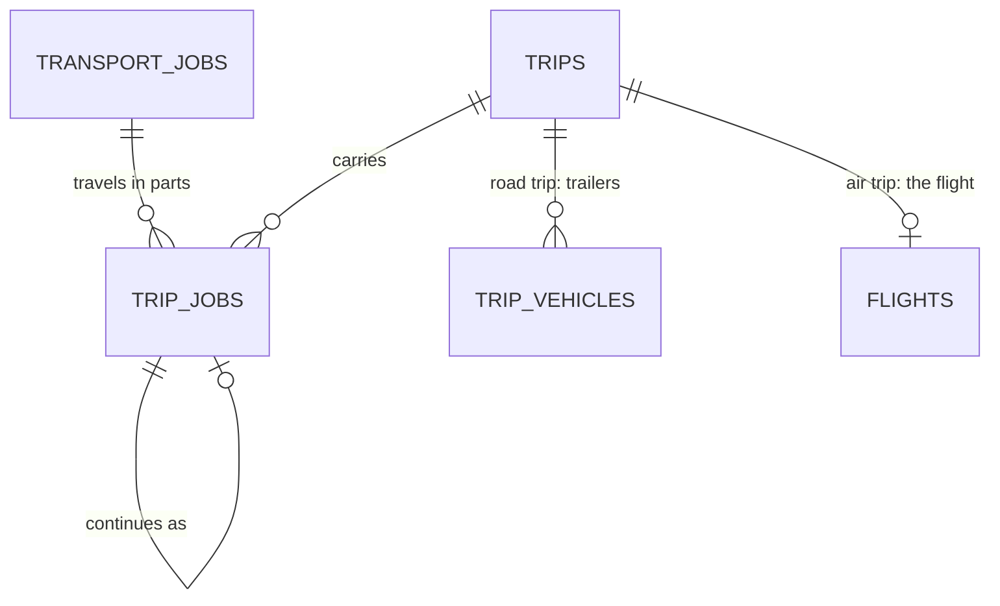

# One job, several trips: road, air, road

Status: built (US-F3-16, #206), 25 Oct 2026. See [As built](#as-built) for where the build differs from the plan below. Builds on `docs/shared-trips-design.md`, which already lets a job span trips after an incident (US-F5-06, `trip_jobs`).

## Why

A job that flies is really three moves: trailers take the horses from their stables to the departure airport, the airline flies them, and after release at the arrival airport (often after days in import quarantine) other trailers take them to their stables, sometimes across one or more borders. Today one job is planned as one trip, so the same `trip_vehicles` convoy is booked from the first pickup to the final delivery, as if the trailers flew with the horses. The trailers after landing are a different set, often on a different date and sometimes with a local partner's crew.

## Decisions (agreed 25 Oct 2026)

| Question | Decision |
| --- | --- |
| Shape | **A chain of trips per job:** one trip per leg of the journey, e.g. road → air → road. The job stays the commercial and legal unit. |
| The flight | **Its own trip.** An air trip's flight plays the part a trailer plays on a road trip: the flight number takes the vehicle's place, so no rule is broken by a trip that has no trailer. |
| Who makes the chain | **The fleet coordinator, while planning,** except for a request that goes by way of hubs (US-F1-09): its approval puts the job on the chain its route names, the domestic leg to the hub, the corridor that crosses the border, and the leg from the hub. Otherwise approval puts the job on one trip and the coordinator adds the next trip on the Route tab. |
| Corridors | **Every trip has a catalog corridor of its own mode.** The air trip uses an air corridor ("AIR BKK → HKG"); each road trip a road corridor ("RD VTE → BKK", "RD HKG → Sha Tin"). Sharing a trip with other jobs keeps working, because sharing is "same corridor". |
| Price | **Unchanged.** The quotation already covers door to door (ground lines and air). Splitting the journey into trips is planning only, like sharing; invoices stay per job. |

## The model

An example: four horses from Vientiane to Sha Tin, two trailers each side.

| Trip | Corridor | Carrier | From → to | Ends with |
| --- | --- | --- | --- | --- |
| TRP-2026-041 | RD VTE → BKK | 2 trailers (convoy) | Vientiane stable → BKK cargo terminal, border at Nong Khai | `HANDED_ON` at the airport |
| TRP-2026-042 | AIR BKK → HKG | Flight CX 2071 | BKK → HKG | `HANDED_ON` at release |
| TRP-2026-043 | RD HKG → Sha Tin | 2 trailers (convoy) | HKG quarantine → Sha Tin stables | `DELIVERED`, then handover |

Each trip can still be shared with other jobs on its own corridor, and each is planned, signed off, departed and logged on its own. Each road trip takes only a vehicle that works its corridor and is in the country it starts in (US-F7-01), so the road leg after a flight needs a vehicle based at the arrival end, or one whose last trip ended there; the air trip carries no vehicle and isn't checked.

### Changes

| Table | Today | Becomes |
| --- | --- | --- |
| `trips` | `corridor_id`, any mode; one trip per job before departure | Unchanged columns. The trip's mode is its corridor's. A road trip carries trailers (`trip_vehicles`, load plans, drivers, grooms); an air trip carries one flight and no trailers. |
| `trip_jobs` | One row per part of a job on a trip | Adds `next_trip_job_id null`, the part it hands on to, so the chain is explicit and survives an incident moving horses. |
| `trip_horses.status` | `ON_TRIP`, `MOVED`, `DELIVERED`, `LEFT_IN_CARE` | Adds `PLANNED` (on a later trip of the chain, not loaded yet) and `HANDED_ON` (left this trip for the next trip of the chain). The "one trip at a time" index (`status = 'ON_TRIP'`) is unchanged, so a horse is `PLANNED` on trip 3 while it is `ON_TRIP` on trip 1. |
| `route_stops.kind` | `PICKUP`, `DELIVERY`, … name the job | Adds `TRANSFER`, which names the job like `PICKUP` and `DELIVERY` do: the stop where that job's horses leave this trip for the next one. A trip that hands on ends at a `TRANSFER`; the next one starts at a `PICKUP` at the same place. `DELIVERY` (and so the handover) only exists on the last trip of the chain. |
| `flights` | One per air `route_leg` | Unchanged. On an air trip the flight is the carrier; its `flight_allocations` are the per-job "load plan" (stall positions, waybill). |
| `crew_assignments` | Trailer crew, or flight crew (no trailer) | Unchanged. An air trip has only flight crew; a road trip only trailer crew. |
| `vehicle_bookings` | One per trailer for the trip's span | Unchanged, and now right: each road trip books its own trailers for its own dates, so the onward trailers aren't blocked during the flight and quarantine. |

The "a trip keeps at least one trailer" rule (`LoadPlanService`) becomes **a trip keeps at least one carrier**: a trailer on a road trip, the flight on an air trip.

## Rules

**Adding the next trip.** On a job's Route tab, before the job's current trip departs, the coordinator picks a stop on the trip's draft route (an `AIRPORT_OUT`, `AIRPORT_IN` or `QUARANTINE` place) and "continues on another trip". The app:
1. turns that stop into a `TRANSFER` for the job and drops the job's stops after it from this trip (the trip's route reopens as a new draft version);
2. creates the next trip with a corridor of the next mode starting at that place, chosen by the coordinator from the catalog, or puts the job on an existing trip on that corridor (the joining rules of shared trips apply);
3. adds the job's horses to it as `PLANNED`, with a `PICKUP` at the transfer place and the job's `DELIVERY` (or another `TRANSFER`) at the end.

Removing a trip from the chain is the reverse, before either trip departs.

**Handing on.** The record that ends trip N at its `TRANSFER` stop (`ACCEPTED_BY_AIRLINE` when a road trip leaves the horses with the airline, `RELEASED_BY_AIRLINE` when the air trip lands them) marks the job's horses `HANDED_ON` there and `ON_TRIP` on trip N+1. The job's part on trip N is done; the trip is done when no job is left on it, as today.

**Departure.** Each trip departs on its own and keeps the clearance gate: every job with horses `ON_TRIP` must be `CLEARANCE_READY`. The exception is a domestic leg before the border (US-F2-13): a trip that stays in one country and hands on, down the chain, to one that crosses a border departs, and is signed off, before the dossier clears, because the export checks happen where the move leaves the country. The job itself departs only with the trip that crosses the border: until then its `departed_at` stays empty, its stage doesn't move to Trip, and its documents stay open and are checked against that trip's planned departure (the job's own until that trip's route is confirmed). Trip N+1 can't depart before its horses are handed on to it. Planned times must follow each other: trip N+1's pickup at or after trip N's transfer, plus quarantine (the `QUARANTINE` stop's planned stay).

**Delivery and handover.** Only the last trip has the job's `DELIVERY`; handover, the late-arrival penalty and the final invoice work as today. An arrival window (road only, private trailer) applies to the last trip's delivery.

**Incidents.** Unchanged: an incident can still move horses to a new trip. The new trip takes the moved horses' place in the chain (`next_trip_job_id` is repointed), so the onward trips still follow.

## Screens

- **Job › Route / Load plan / Crew tabs:** a journey rail to the left of the tabs (as built; DESIGN.md, Job page), first planned as a trip switcher above the tabs ("1 · Road VTE → BKK · 2 · Air BKK → HKG · 3 · Road HKG → Sha Tin"). Every job-scoped endpoint that today resolves "the job's current trip" (`TripRepository.findCurrentByJobId`, used by about 38 call sites in 12 services) takes an optional `tripId`, defaulting to the current trip. On an air trip the Load plan tab shows the flight's allocations instead of trailers.
- **Customer tracking:** one timeline across the job's trips, in chain order, still without trip codes or other clients.
- **Fleet calendar:** unchanged; each road trip's bookings show on their own dates.

## As built

- **No `seq` column.** The order of a journey follows `next_trip_job_id`; the job's parts are listed in that order. The column isn't unique: an incident that moves some horses off a trip of the journey links their new trip to the same next trip, so they join the others there.
- **Handing on is the delivery at the transfer.** On a part that hands on, `ARRIVED_AT_STOP` at the `TRANSFER` stop and then `DELIVERED` hand the horses on to the next trip instead of delivering the job; a `HANDED_OVER` record there is refused. The airline records (`ACCEPTED_BY_AIRLINE`, `RELEASED_BY_AIRLINE`) stay entries in the log.
- **Where a journey splits.** Only at an `AIRPORT_OUT`, `AIRPORT_IN` or `QUARANTINE` stop before the job's delivery. A stop shared with other jobs on the trip stays, and the job's `TRANSFER` is added after it. The next trip's pickup is planned at the stop's time plus its stay.
- **Times follow each other.** Confirming a trip's route checks it against its neighbours in the journey: the job's pickup can't come before the trip before has the horses ready (its `TRANSFER` time plus the planned stay there, or the stay of the stop just before it at the same place when the transfer was added beside a shared stop), and its `TRANSFER` plus stay can't come after the next trip's pickup. The neighbour's draft is read before its confirmed route, so the coordinator moves the later trip first, then the earlier one.
- **Joining an existing trip** is the shared-trip flow on the later trip (its Load plan tab), not part of "continue on another trip". On a later trip of a journey its days are that trip's own pickup moved by the corridor's flex days, and never before the day the trip before has the horses ready.
- **Air trips.** A trip whose confirmed route has no road leg is signed off without load plans or drivers; its flight crew is checked as for any flight. The airports a flight joins on are read from its air legs, not from the `AIRPORT_OUT` and `AIRPORT_IN` stops.
- **Incidents branch the journey.** Horses moved to a second vehicle, or unloaded to continue later, keep going: their new trip hands on to the journey's next trip, where they join the others. Horses left in care, or returned to their origin, leave the journey: they come off every later trip (out of their stalls there), a later trip with none of the job's horses left drops out of the chain, and it releases its trailers and crew when nobody else rides it, or reopens without the job's stops when others do.
- **Every job-scoped planning endpoint** takes `?trip=`; the job page keeps the chosen trip in its URL.
- **Crew are booked per trip.** A crew member is busy for each trip's own planned span (its route's first planned time to its last, plus that stop's stay), not for the job's whole journey: a groom can ride the trailer to the airport and fly with the horses on the next trip.
- **The customer's timeline.** Without `?trip=`, the customer's tracking view of a journey merges every trip's own view in chain order: one numbered list of stops (a later trip's pickup at the transfer place is left out), every record in the order it happened, every trip's flights, and the job's own status and times. Opening one trip shows only that trip, with a way back to the whole journey. A delivery recorded at a `TRANSFER` reads "Handed on to the next trip", and a trip that handed on shows "Handed on".

## Not in scope

- Automatic chains at approval, other than the domestic legs of a route by way of hubs (US-F1-09).
- Pricing per trip; the quote stays door to door.
- A trip with two flights for one air leg (already out of scope in shared flights).

## Open questions

1. Local moves such as "HKG airport → Sha Tin" need small road corridors in the catalog. Who adds them? The demo seed has the SGN, PNH and HKG airport cargo terminals and "RD HKG → Sha Tin", so the demo can split a journey HCM → PNH → HKG → Sha Tin.
2. Long-haul chains (Hong Kong → New York: road, air, road to the USDA quarantine at Newburgh, road) fit the model once the country is in the catalog (PRODUCT.md, Region). The code works in one business time zone (`BusinessTime.ZONE`); planned times and deadlines across 12+ hours of offset need each place's own zone. Not checked yet.
3. Does the departure airport's export inspection (the horses waiting at the airport before loading) belong to the road trip's `TRANSFER` stop stay or to the air trip's first stop?
