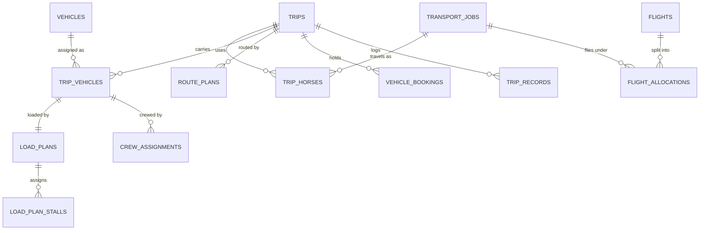

# Shared trips: several jobs in one trailer, one job across several trailers

Status: decided, ready to split into tickets (23 Oct 2026). Nothing here is built yet.

## Why

Today one approved request becomes one job, and one job has exactly one trailer: `load_plans` has a single `job_id` and `vehicle_id`, a job has one confirmed load plan, and `vehicle_bookings_no_overlap` stops two jobs from even reserving the same trailer at overlapping times. So two small requests on the same corridor in the same week, say two horses each, each take a whole trailer, and a request with more horses than one trailer holds has no way to be planned at all.

## Decisions (agreed 23 Oct 2026)

| Question | Decision |
| --- | --- |
| Scope | Both: **sharing** (several jobs in one trailer) and **splitting** (one job across several trailers). |
| Who combines jobs, and when | The **fleet coordinator, after approval**, while planning. The app suggests jobs that fit. |
| Price | **Unchanged.** Space is already priced by stall width, so each customer keeps their quoted price; sharing saves the company a trailer. The locked price and horse list are untouched. |
| Routes | **Same catalog corridor.** Different pickup or drop-off points become extra stops on one route plan. |
| Model | A new **Trip** above jobs: one trip holds 1+ jobs and 1+ vehicles. Jobs keep their CBRT codes. |
| Splitting | A split job's trailers travel **together, as a convoy**: one route, one schedule, cleared and departing together. |
| A job not cleared by departure | The trip waits for every job; the coordinator can **take the stuck job out** so the others leave, and that job is replanned. |
| What the customer sees | **That the trailer is shared, nothing about the other client** (no names, horses or documents). |
| Compatible dates | **Inside both windows:** one departure time inside each job's allowed departure, and each drop-off's planned arrival inside that job's arrival window. |
| Biosecurity | **Warn, the coordinator decides:** the app warns, but doesn't block, on an isolation mismatch, different required health tests, or health documents not yet clear. Derived only from data the app already holds; checked when combining and again when the trip is confirmed. See [Health status](#health-status). |
| Leaving after departure | **Only through an incident, decided by the logistics manager.** The incident offers unloading at a safe place, a second vehicle, or a return to origin; the other jobs carry on with a new route version; who pays is decided per incident. See [Leaving a moving trip](#leaving-a-moving-trip). |
| Part of a job leaving | **A job can span trips after departure.** An incident can move some of a job's horses (one ill horse out of four) to a new trip; delivery is per horse, the job is delivered when every horse is; the horse that stays behind has its clearance re-checked for its new dates. See [Part of a job leaving](#part-of-a-job-leaving). |
| Flights | **Shared too.** Jobs on one trip fly together on the trip's flight; each job keeps its own air waybill, stall positions and flying grooms in a per-job allocation. See [Shared flights](#shared-flights). |
| Trip code | **Staff and the escort only.** Customers only ever see their own `CBRT` job code. |
| Customer notifications | **Three new kinds:** joining a shared trip, times changing because the trip changed, and being taken off a trip before departure. See [Customer notifications](#customer-notifications). |
| Combining after plans are confirmed | **Allowed; plans reopen.** Adding or removing a job sends the trip's route and load plans back to draft, and sign-off happens again. |

## The model

A **trip** is what physically moves: a route, a schedule, one or more vehicles with their crews, and the horses of one or more jobs. A job stays the commercial and legal unit: its request, quotation, price, invoices, clearance checklist and documents, customer notes and handover.

Before departure, every job is on exactly one trip: all its horses travel together. After departure, an incident can move some of a job's horses to another trip, so from then on a job's horses can be on two trips (see [Part of a job leaving](#part-of-a-job-leaving)). A job that shares nothing is a trip with one job and one vehicle, so today's single-job flow is the simple case of the new model, not a separate path.

### New tables

| Table | Columns | Rules |
| --- | --- | --- |
| `trips` | `code` (`TRP-YYYY-NNN`, from `code_counters`), `corridor_id`, `status` (`PLANNING`, `READY`, `IN_TRANSIT`, `HELD`, `DELIVERED`, `CANCELLED`), `planned_departure_at`, `created_by` | Unique `code`. All of a trip's jobs share its corridor (checked by the application on every add). |
| `trip_vehicles` | `trip_id`, `vehicle_id`, `seq` | Unique `(trip_id, vehicle_id)`. A convoy is a trip with several rows. |
| `flight_allocations` | `flight_id`, `job_id`, `air_waybill`, `stall_positions`, `service_class` | One per job on a flight: unique `(flight_id, job_id)` and unique `air_waybill`. The job's own consignment: its waybill, the stall positions its horses use, and its service class. Airport customs and documents stay per job. |
| `trip_horses` | `trip_id`, `job_id`, `horse_id`, `status` (`ON_TRIP`, `MOVED`, `DELIVERED`, `LEFT_IN_CARE`) | Which horse rides which trip. A horse is on one trip at a time: unique `horse_id` where `status = 'ON_TRIP'`. The horse must belong to the job. Before departure, all of a job's horses are on the same trip (checked by the application). A horse moved by an incident keeps its old row as `MOVED`, so history shows where it was. |

### Changes to existing tables

| Table | Today | Becomes |
| --- | --- | --- |
| `transport_jobs` | — | No trip column: a job's trips are those of its horses in `trip_horses`. Removing a job from a trip before departure moves all its horses to a new single-job trip, never to none. |
| `load_plans` | `job_id`, `vehicle_id`; one confirmed plan per job | `trip_vehicle_id` (unique). One load plan per vehicle on the trip. The "one confirmed plan per job" index goes; instead **every horse of every job on the trip is placed on exactly one of the trip's load plans** before the trip can be confirmed. |
| `load_plan_stalls` | `load_plan_id`, `vehicle_stall_id`, `horse_id` | Unchanged, plus a check that the horse is `ON_TRIP` on this trip (`trip_horses`). Unique horse per trip, not just per plan, so a horse can't be on two trailers. |
| `vehicle_bookings` | `job_id null` | `trip_id null` instead of `job_id`. The no-overlap constraint is unchanged: one booking per vehicle per trip, so sharing never needs two bookings for one trailer. |
| `crew_assignments` | Primary key `(job_id, user_id)` | Belongs to a trailer (`trip_vehicle_id`) or a flight (`flight_id`), exactly one of the two. Grooms = ⌈horses on that trailer or flight ÷ 3⌉; flying grooms and a flight vet are assigned to the flight. |
| `flights` | `route_leg_id` unique, `airline`, `flight_no`, `air_waybill`, `aircraft_type`, `stall_positions`, `service_class`, times | Stays one row per air leg of the trip (airline, flight number, aircraft, times). `air_waybill` and `stall_positions` move to `flight_allocations`; the flight's total stall positions are the sum of its allocations. |
| `route_plans` / `route_stops` / `route_legs` | Per job | Per trip. A `PICKUP` or `DELIVERY` stop gains `job_id`, so each job's own pickup and drop-off are known. Border and welfare stops belong to the whole trip. |
| `trip_records`, `condition_logs` | Per job | Per trip. A condition log names the horse, so each customer's view filters to their own horses. |
| `handovers` | Per job | Per job and trip: each job is handed over at its own `DELIVERY` stop to its own receiver, for the horses on that trip. A horse left in a vet's or stable's care is recorded as `LEFT_IN_CARE` with the place. A job is delivered when every horse is handed over or accounted for, and its final invoice waits until then. A trip is `DELIVERED` when every horse on it is. |
| `incidents` | Per job | Per trip, with the affected jobs listed. A hold at a border affects every job on the trip, and each customer is told about their own horses. |

Clearance (`checklist_items`, the gate), quotations, invoices, notes and the pinned regulation catalog stay per job.

## Rules

**Joining a trip.** The coordinator can add job B to job A's trip when:
1. Same corridor.
2. **Dates fit both windows:** there is one departure time inside each job's allowed departure (its date ±3 days, or the window it bought), and the planned arrival at each job's drop-off falls inside that job's arrival window. The app proposes such a departure time, or says which window rules it out.
3. **Space:** the trip's vehicles have enough stalls of the right types for all horses, and payload stays within limits. If not, the coordinator adds a vehicle (splitting).
4. **Biosecurity warning, not a block:** see [Health status](#health-status). The coordinator can go ahead; the warnings they accepted are recorded in the audit log with who chose it.

**Joining a trip that flies.** When the trip has an air leg, two more checks apply: the job uses the same departure and arrival airports, and the flight has enough stall positions for its horses (the airline's limit for that aircraft). Adding the job creates its flight allocation, with its own air waybill to be filled in.

**Suggestions.** On a job's Load plan or Route tab, the app lists approved jobs not yet departed whose corridor and windows fit, with spare stall space after combining. Nothing combines automatically.

**Reopening.** Adding or removing a job, or adding or removing a vehicle, sends the trip's confirmed route plan and load plans back to `DRAFT` (a new route plan version, so history stays as evidence) and clears the trip sign-off. The coordinator re-places horses and reconfirms. Nothing confirmed changes silently.

**Departure.** A trip can depart only when every job on it is `CLEARANCE_READY` and every load plan is confirmed. If one job isn't ready, the coordinator can take it out: it moves to a new single-job trip, the old trip's plans reopen, and the job's customer is told it's being replanned.

**Convoy.** A trip's vehicles share one route plan and schedule, depart together, and are recorded at each stop together. After departure, a vehicle leaves the convoy only as part of an incident decision (see [Leaving a moving trip](#leaving-a-moving-trip)).

**Leaving a moving trip.** See [Leaving a moving trip](#leaving-a-moving-trip): after departure the coordinator can't remove a job; only an incident decision can.

**Stall rules across customers.** Existing load plan conflicts (box need in a standard stall, stallion beside a mare, payload) apply across all horses on the trailer, whichever job they belong to.

## Shared flights

A trip's air leg has one flight, and every job on the trip flies on it. What stays per job is the consignment: each job has a flight allocation with its own air waybill, its stall positions and its service class, and its own airport customs and documents.

- **Crew.** Flying grooms and, above the high-value threshold, a flight vet are assigned to the flight, counted for all horses on it.
- **Biosecurity.** The same warnings as for a trailer (see [Health status](#health-status)) apply to the horses sharing a flight's stalls.
- **Leaving.** A job can't leave a flight in the air. A job or some of its horses can leave only at an airport, through the same incident options as on the road (see [Leaving a moving trip](#leaving-a-moving-trip)); a horse that misses the flight gets its own allocation on a later flight of its new trip.
- **The customer** sees their own waybill and stall positions, and the same "travels with another client's horses" line, with nothing about the other consignment.
- **Out of scope for now:** a trip using two flights for one air leg (splitting on air, when one flight can't take every horse). The trip has one flight per air leg; a job too big for that is planned as its own trip.

## Leaving a moving trip

Once a trip has departed, a job (or some of its horses, see [Part of a job leaving](#part-of-a-job-leaving)) leaves it only through an incident, and the logistics manager decides, as for every incident (DESIGN.md, Incident). Typical causes: a horse falls ill at a welfare stop, or a border post holds one job's horses over their documents while the others are cleared.

**The options.** The incident lists, side by side with their cost (arrival, documents, the horse, money and who bears it):

1. **Unload at a safe place, continue later.** The job's horses are unloaded at the nearest suitable place (a vet clinic, quarantine station or stable) and stay there; the job continues later on a new trip of its own.
2. **Send a second vehicle.** Another vehicle collects the job's horses where they are and carries them on, as a new trip for that job.
3. **Return to origin.** The horses go back to their pickup place, and the job is rescheduled or cancelled.

**What deciding does.**
- The leaving horses move to a new trip (`TRP` code). Its records so far (trip log, condition logs) stay on the trip where they happened and are shown on the job's history; nothing is copied or rewritten.
- The original trip continues with the remaining jobs. If the decision adds a stop (an unloading place) or a delay, the trip gets a new route plan version with the reason, and the old version is superseded, not edited.
- If the delay pushes another job's arrival outside its window, that job gets its own incident, so its customer is told and the manager decides for them too.
- The message to the leaving job's customer is required and sent as written. The other customers are told only what changes for them (a later arrival, an extra stop), never why or whose horses.
- Who pays is part of the chosen option. A charge to a customer appears on that job's final invoice as a line marked as an incident cost; the quoted price itself never changes.
- **Convoys.** A trailer that carries only the leaving job's horses can leave the convoy with them and becomes the new trip's vehicle (its crew goes too). A trailer still carrying another job's horses stays on the trip, so those horses are unloaded or collected by a second vehicle.

### Part of a job leaving

When only some of a job's horses must leave (one ill horse out of four), the same incident options apply to just those horses, and the rest of the job stays on the trip. This is the one case where a job spans trips; before departure it never does.

- **Horses, not the job, move.** The leaving horses' `trip_horses` rows become `MOVED` and they get rows on the new trip. The job now has two parts, and its page shows both: which horses are where, on which trip, with which crew.
- **Delivery is per horse.** Each part is handed over at its own delivery, or a horse is recorded as `LEFT_IN_CARE` (a vet clinic, a stable) if it won't travel on. The job is delivered when every horse is handed over or accounted for; the final invoice waits until then.
- **Clearance is re-checked for the new dates.** The horse that stays behind still has border crossings ahead. Its per-horse documents (vaccination, tests, health certificate) are re-checked against the new trip's departure and crossing dates; anything that turns `AMBER` or `RED` must be cleared again before that trip can depart. Shipment-level documents and permits (an import permit, a border declaration) are flagged for the transport specialist to confirm they still cover the horse on its new trip.
- **The customer** sees both parts on tracking: where each of their horses is and when each is expected, from the incident's required message onwards.

## Health status

Health status is never typed in: it's derived from what each job's clearance already records, so it can't drift from the documents. The app compares every pair of jobs on a trailer and warns on any of three differences. Each warning names the jobs, the horses and the reason in plain words.

1. **Isolation mismatch.** Horses that went through quarantine or pre-export isolation for this move (a `quarantine_periods` row for the horse, or for its job's whole load) are a closed group. The app warns when a trailer mixes horses from different isolation groups: an isolated group with horses that weren't isolated, or two groups isolated in different periods or places.
   > TRP-2026-004: Silver Bell and Copper King (CBRT-2026-041) finish pre-export isolation at Phú Thọ on 16 Oct; CBRT-2026-047's horses weren't isolated. Sharing a trailer ends that isolation.
2. **Different health tests required.** Each job's pinned regulation version decides which health documents its horses need. The app warns when the jobs on a trailer require different sets, for example only one needs a piroplasmosis test, because the other job's horses haven't been tested for it.
3. **Health documents not yet clear.** When combining, and again before the trip is confirmed, the app warns about any mandatory health document of a horse on the trailer that isn't `CLEARED` and `GREEN` for the trip's planned departure. This is about mixing: the departure gate still blocks the trip until every job clears, as before.

**What counts as a health document.** `document_types` gains `category` (`HEALTH`, `IDENTITY`, `PERMIT`, `TRANSPORT`), maintained in the regulation catalog like the rest of it. Checks 2 and 3 use `HEALTH` only: influenza vaccination, EIA (Coggins) test, piroplasmosis test and the export health certificate today; the equine passport is `IDENTITY`.

**When it's checked.** When the coordinator adds a job (or moves a horse between trailers), and again when the trip's load plans are confirmed. A warning that appears only at confirmation, because a document expired or quarantine changed since, has to be accepted again before the trip is confirmed; warnings already accepted and unchanged aren't asked twice.

## What each person sees

- **Customer:** their own job only, under its `CBRT` code; the `TRP` code is never shown. Tracking and the trip log show their horses, their pickup and drop-off, and the shared border and welfare stops. When the trailer carries other jobs, one line says the horses travel with another client's horses, with nothing about who or which. Stops that exist only for another job are shown as "a stop on the way", without the place. A hold or incident is described in terms of their own horses.
- **Fleet coordinator:** a trip page (or a Trip section on each job) with all jobs, vehicles, the combined route and one load plan per trailer, where horses are labelled with their job code. Combining, splitting and removing happen here.
- **Logistics manager:** each job page keeps its price, quotation and invoices; a "Shared with 1 other job" note links to the trip.
- **Escort:** the cab surface is per trailer: it shows that trailer's horses and the trip's stops, with each delivery stop naming the job being handed over there.

## Customer notifications

New kinds for the notification centre (docs/notification-centre.md, section 6). All go to the job's club accounts, are e-mailed, show the job's `CBRT` code (never the `TRP` code) and open the job's tracking page. None of them names, counts or describes the other client.

| Kind | Raised when | Title | Body |
| --- | --- | --- | --- |
| `TRIP_SHARED` | The coordinator confirms a trip that carries the job and at least one other job. Not on drafts, and not again on a later confirmation unless the job wasn't shared before. | Your horses will share a trailer | CBRT-2026-041 will travel with another client's horses on the same trailer, leaving Hồ Chí Minh City on 18 Oct at 13:00. Your price, your arrival window and your documents don't change. Each horse keeps its own stall, and the escort cares for every horse on board. |
| `TRIP_TIMES_CHANGED` | A confirmation moves the job's planned departure or arrival because the trip changed (a job joined or left). Only when the job's own times change. | New times for CBRT-2026-041 *(draft wording)* | Your horses now leave Hồ Chí Minh City on 19 Oct at 08:00 and arrive between 21 Oct 18:00 and 21:00, still inside your window. Your price doesn't change. |
| `JOB_REPLANNED` | Before departure, the job is taken off a shared trip. | CBRT-2026-041 is being replanned | Your documents weren't cleared in time for the trailer leaving on 18 Oct, so your horses won't travel on it. We're planning a new departure inside your window and will confirm it here. Your price doesn't change. |

- The first sentence of `JOB_REPLANNED` gives the job's own reason. For a cause other than its clearance (for example the coordinator rebuilding the trip), it reads "The plan for the trailer leaving on 18 Oct changed, so your horses won't travel on it."
- After departure, a job leaving or a delay goes through an incident, whose customer message is written by the logistics manager and sent as written (see [Leaving a moving trip](#leaving-a-moving-trip)); these kinds aren't used then.
- De-duplication follows the notification centre: `dedupe_key` per job and trip confirmation, so reconfirming the same plan doesn't post twice.

## Migrating today's data

1. Create one trip per existing job (`TRP` code), with one `trip_vehicles` row from its load plan's vehicle and one `trip_horses` row per horse on the job.
2. Point the job's load plan, booking, crew, route plan, trip records and condition logs at the new trip or trip vehicle.
3. Give each existing flight one `flight_allocations` row for its job, carrying the flight's air waybill, stall positions and service class.
4. Then drop the old `job_id` columns, the flight's `air_waybill` and `stall_positions`, and the per-job unique indexes.

Done as data migrations in `BE/src/main/resources/db/migration/`. Every existing job behaves exactly as before, as a one-job trip.

## Still open

Every design question was settled on 23 Oct 2026. One piece of wording is still a draft to confirm: the `TRIP_TIMES_CHANGED` notification.

## Suggested tickets, in order

1. Trip model and migration: `trips`, `trip_vehicles`, `trip_horses`, moving bookings, load plans, crew, route and trip records to the trip, with every existing job as a one-job trip. No behaviour change.
2. Splitting: add a second vehicle to a trip, one load plan per trailer, convoy departure.
3. Sharing: add or remove a job, the corridor, window and space checks, reopening plans.
4. Health status: `document_types.category`, the three biosecurity warnings, accepting them on combining and at confirmation.
5. Suggestions of compatible jobs on the Load plan and Route tabs.
6. Customer and escort views of shared and split trips, and the three customer notifications.
7. Leaving a moving trip: the three incident options for a whole job or some of its horses, per-horse delivery, and the clearance re-check for horses that stay behind. Depends on the incident flow (Flow 5), still undecided in PRODUCT.md.
8. Shared flights: `flight_allocations` with per-job air waybills, crew on the flight, and the airport and capacity checks when joining a trip that flies.
